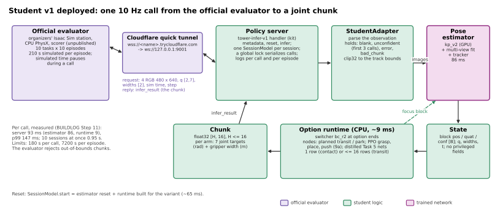
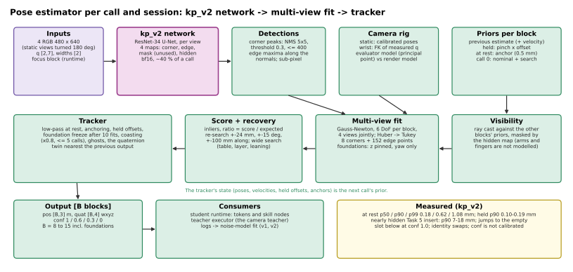
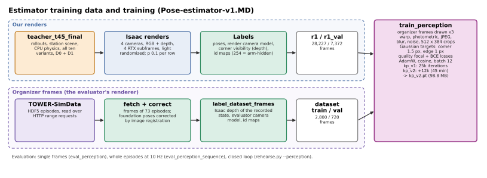
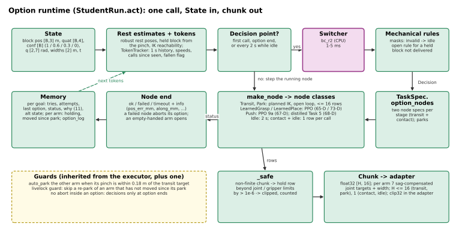
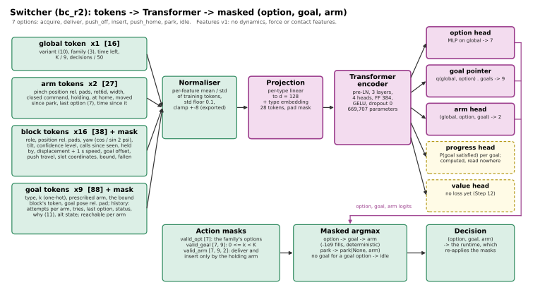
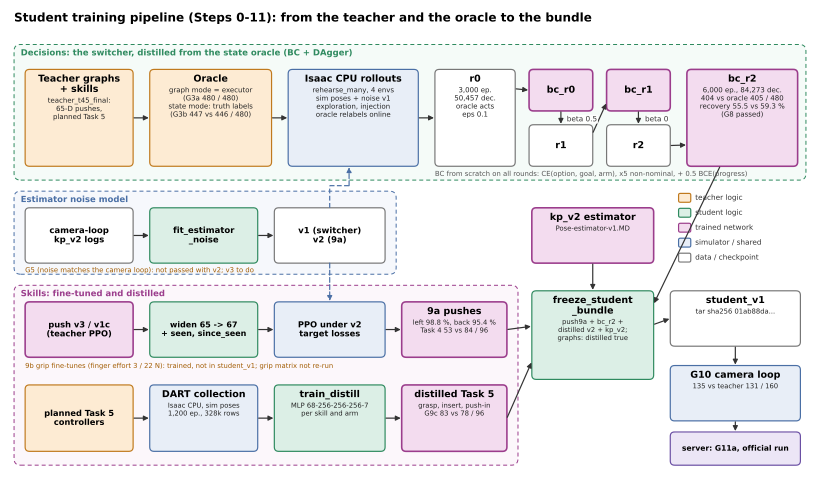

# Student v1: the deployable student

*Written 2026-10-24. This describes `student_v1`, the bundle submitted as official run 1, and the code around it in `~/Documents/tower_rl`. That code is HEAD `f5e8cce` plus uncommitted student and server work. The document goes through every component: what goes in and out, how it is trained or set up, and how it connects to the rest. The teacher, and the simulation, scoring and controllers it shares with the student, are in `Teacher-v1.MD`; this document refers to that one as **T**, so "T §2.7" means Teacher-v1.MD section 2.7. The diagrams are SVGs in `figures/student-v1/`, regenerated by `~/Documents/tower_rl/scripts/doc_figures.py`.*

*Sources and conventions:*
- *Code is cited as `file:line`, relative to `~/Documents/tower_rl`.*
- *BL «…» is a `BUILDLOG.md` section.*
- *PE is `Pose-estimator-v1.MD`, PR1 is `Student-distillation-progress-1.MD`, and plan is `Student-distillation-plan.MD`.*
- *Where those docs and the code disagree, the code is described here, and §10 lists the differences.*

---

## Contents

1. [What the student is](#1-what-the-student-is)
2. [Perception: the pose estimator](#2-perception-the-pose-estimator)
3. [The decision layer: spec, runtime, oracle, tokens, switcher](#3-the-decision-layer)
4. [Skills in the student](#4-skills-in-the-student)
5. [Training pipeline](#5-training-pipeline)
6. [Deployment: server, sessions, adapter](#6-deployment-server-sessions-adapter)
7. [The bundle `student_v1`](#7-the-bundle-student_v1)
8. [Results and known gaps](#8-results-and-known-gaps)
9. [Facts for the open design questions](#9-facts-for-the-open-design-questions)
10. [Docs vs code](#10-docs-vs-code)
11. [Appendix: file map](#11-appendix-file-map)

---

## 1. What the student is

The student is what the official evaluator talks to. On each 10 Hz call it receives four RGB images, the joint positions, the gripper widths and the time, and it returns a chunk of up to 16 joint rows. It has three parts.

1. **Perception** replaces the teacher's exact block poses with estimates. A keypoint network (kp_v2) runs on each of the four views. A multi-view box fit and a per-episode tracker then give a pose and a confidence for every block, foundations included.
2. **Decisions** replace the teacher's fixed node pointer:
   - an *option runtime* runs one option at a time, for example "acquire goal 2 with the left arm";
   - each option expands into the same skill nodes the teacher uses;
   - a *switcher* (a Transformer over tokens) picks the next option at each decision point;
   - the switcher was distilled by BC and DAgger from a truth-reading *state oracle*.
3. **Skills** are mostly the teacher's:
   - planned transit and park;
   - the PPO grasp and place policies, unchanged;
   - PPO pushes retrained against the estimator's loss of the target (Step 9a);
   - BC networks distilled from the planned Task 5 controllers with DART noise (Step 9c).

Nothing in the student reads simulator truth. Every input is computed from the evaluator's observation (§9).

*Figure 1. One call through the deployed student. The evaluator reaches the server through a Cloudflare quick tunnel. A session's adapter turns the observation into a State: it runs the pose estimator and passes the joints, widths and time through. The option runtime turns that State into a chunk. The runtime's current goal block goes back to the estimator as its "focus" for the next call.*

### 1.1 Results so far

| Run | Setting | Result | Source |
|---|---|---|---|
| **G10 (Step 10)** | camera loop: our Isaac renders → kp_v2 → student; seed 7000; 8 episodes per tier and variant | **135 / 160**, against the camera teacher's 131 / 160 Tasks 1-3: 96 / 96 Task 4: 18 / 32 Task 5: 21 / 32 | BL «Results of Step 10 / G10» |
| Video run | camera loop, 50 episodes | 40 / 50 | BL «Results of the `student_v1` video run» |
| G11a | the same episodes through the server's WebSocket | 13 / 16, against 12 / 16 in process | BL «G11a» |
| **Official run 1** | `student_v1`, all ten tasks, 10 Hz, 10 episodes per task | qualification passed; queued 2026-10-24 ~11:20; **no result yet** | BL «Official run 1» |

G10 per variant (successes out of 8, D0 / D1):

| | 1-2 | 1-3 | 2-2 | 2-3 | 3-2 | 3-3 | 4-2 | 4-3 | 5-2 | 5-3 |
|---|---|---|---|---|---|---|---|---|---|---|
| student_v1 | 8 / 8 | 8 / 8 | 8 / 8 | 8 / 8 | 8 / 8 | 8 / 8 | 6 / 3 | 5 / 4 | 7 / 5 | 6 / 3 |
| camera teacher | 8 / 8 | 8 / 7 | 8 / 8 | 8 / 8 | 8 / 8 | 8 / 7 | 5 / 4 | 4 / 2 | 8 / 4 | 7 / 3 |

### 1.2 Component index

| Layer | Component | Kind | Code | Trained / set up by |
|---|---|---|---|---|
| Perception | camera models | analytic | `perception/cameras.py` | station calibration + FK; verified to 0.25 px |
| Perception | kp_v2 | CNN, ResNet-34 U-Net | `perception/model.py` | renders + organizer frames (§2.2) |
| Perception | multi-view fit, tracker | robust optimisation + state machine | `perception/estimator.py` | thresholds tuned on renders and organizer episodes |
| Decisions | task spec | compiler | `student/spec.py` | teacher graphs |
| Decisions | option runtime | interpreter | `student/runtime.py` (on `graph/executor.py`) | hand-written; fake-world parity |
| Decisions | oracle (graph / state mode) | rules | `student/oracle.py` | rules + truth |
| Decisions | tokens, masks | encoder | `student/tokens.py` | features v1 |
| Decisions | switcher bc_r2 | Transformer | `student/switcher.py` | BC + DAgger on oracle labels (§5.2) |
| Skills | grasp_lift, place_release | PPO (the teacher's) | T §4.5, §4.7 | unchanged |
| Skills | push (9a) | PPO, fine-tuned | `skills/push_env.py`, `obs.py` | PPO under estimator target losses |
| Skills | Task 5 grasp / insert / push-in | BC MLPs | `student/distill/` | DART data from the planned controllers |
| Deployment | server, adapter | Python services | `server/`, `student/adapter.py`, `scripts/serve_student.py` | the starter kit's protocol |

---

## 2. Perception: the pose estimator

The estimator is a *class-agnostic detector* followed by *model-based fitting*. The network finds block corners and edges in each image; it knows nothing about block identity or pose. Identity, pose and confidence come from fitting known box models to the detections in all four views jointly, with a per-episode tracker. PE describes it in full; this section summarises inputs, outputs, setup and connections. The deployed `perception/kp_v2.pt` is byte-identical to `results/perception/models/kp_v2/model_last.pt`.

*Figure 2. The estimator per call. Detections, camera models and per-block priors feed a joint fit. A recovery stage and the tracker turn the fit into poses and confidences. The tracker's state is the next call's prior.*

### 2.1 Camera models and rig

- **Code:** `perception/cameras.py:27-141`. The edge-registration checks are `perception/calib.py`, `scripts/check_camera_model.py` and `scripts/camera_overlay.py`.
- **Inputs:** `q [2,7]`, used only for the wrist cameras. The static poses come from `assets_m/tower_station_m.json`, and K from `configs/scene.yaml`.
- **Outputs:** one `Camera(K, R_wc, t_wc)` per view, in the station frame. Each has OpenCV axes and a 640 × 480 image, with pixel centres at integer coordinates.

| Challenge id | Station camera | Pose | fx, cx / cy (px) |
|---|---|---|---|
| `left_back_camera` | `low` | fixed (−0.151, −0.878, 0.956) m | 607.13, 331.95 / 243.01 |
| `right_front_camera` | `high` | fixed (0.875, −0.035, 0.558) m | 606.97, 332.10 / 257.00 |
| `left_wrist_camera` | `left_wrist` | FK of the left arm × mount | 607.53, 324.49 / 246.62 |
| `back_wrist_camera` | `back_wrist` | FK of the back arm × mount | same as the left wrist |

- **Orientation:** the static images arrive turned 180°, like the dataset JPEGs. The camera model includes that turn. Our Isaac renders are turned the same way by `deliver()`.
- **Two models:**
  - The *evaluator* model applies the recorded principal point.
  - The *render* model has f = mean(fx, fy) and its centre at (319.5, 239.5), because Isaac ignores the principal point.
  - The two differ by 12-17 px. The server uses `evaluator`; only `ws_loop.py` uses `render`.
- **Validation:** projected edges of the recorded poses fall within 0.25 px of the dataset JPEG edges on every camera (BL «Image formation»).
- **Limits:**
  - At the static cameras' ~1 m working distance, 1 px ≈ 1.5 mm.
  - There is no lens distortion model.
  - The wrist poses are only as good as FK of the measured joints.

### 2.2 Training data and training

*Figure 3. The two training streams: our renders and the organizers' frames.*

- **Renders (r1).**
  - Source: `teacher_t45_final` rollouts on CPU physics, all ten variants, D0 + D1, 16 episodes per tier.
  - Capture: four cameras, RGB + depth, 4 RTX subframes, with probability 0.1 per row.
  - Lighting, randomised per env: 40 % nominal; otherwise intensity ×0.25-2, 3000-8500 K, azimuth ±60°, and tilt up to 30° in half the cases.
  - Size: 28,227 frames (6.5 GB), plus r1_val with 7,372 frames.
  - Labels: poses; visible corners from a depth test with 4 mm tolerance; visible edge points; id maps, with 254 meaning a block surface hidden by an arm or finger.
- **Organizer frames** (the evaluator's own renderer).
  - dataset_val: 720 frames (3 episodes × 24 frames × 10 variants). dataset_train: 2,800 frames (70 episodes × 40 frames).
  - Labels: the recorded poses plus FK.
  - The recorded foundation poses were corrected per pad by image registration: they were off by median 1.0-1.2 mm and up to 6.9 mm.
  - Occlusion labels come from writing the recorded state into Isaac and ray-casting in the evaluator camera model.
- **Augmentation.**
  - Geometric: similarity warp (scale 0.9-1.1, ±4°, ±24 px), random 512 × 384 crops.
  - Photometric: gamma, exposure 0.55-1.45, white balance ±15 %, contrast, saturation, blur, noise σ ≤ 0.012, JPEG quality 70-95.
  - Organizer frames are drawn 3× as often.
- **Network** (`perception/model.py:36-90`).
  - Architecture: a ResNet-34 encoder (ImageNet weights) and a U-Net decoder (256/128/96/64/32 channels), plus a full-resolution 3→24→24 branch.
  - Output: four sigmoid maps at 480 × 640: corner, edge, mask and hidden. The mask head is trained but unused at inference.
  - Peak decoding: 5 × 5 NMS, threshold 0.3, at most 400 peaks, sub-pixel refinement.
  - Size: 98.8 MB.
- **Training** (`scripts/train_perception.py`).
  - Targets: Gaussians with σ 1.5 px for corners and 1.0 px for edges.
  - Loss: quality focal loss for corner and edge; BCE for the mask; BCE with positive weight 5 for hidden. The total is corner + edge + 0.5 mask + 0.5 hidden.
  - Optimiser: AdamW, encoder lr ×0.3, 500-iteration warm-up then cosine, batch 12.
  - Schedule: kp_v1 trained 25k iterations from ImageNet weights at lr 1e-3 (~100 min). kp_v2 continued 12k iterations at lr 5e-4 (2,676 s), with the corrected foundation labels.
- **Detection quality on 400 held-out renders:**

  | Map | Recall / precision | Other |
  |---|---|---|
  | corner (within 3 px) | 98.6 / 97.8 % | matched error median 0.18 px, p90 0.63 px |
  | edge | 99.45 / 98.9 % | |
  | mask | | IoU 0.996 |
  | hidden | | IoU 0.937 |

### 2.3 Multi-view fit

- **Code:** `perception/estimator.py`:
  - model points `:105-123`;
  - visibility `:202-265`;
  - association `:282-336`;
  - fit and score `:339-418`;
  - re-search `:430-470`;
  - table search `:502-559`.
- **Model:** each block is 8 corners plus 152 edge samples. The dimensions are known from the layout.
- **Visibility:** a model point counts if it lies inside the image, a ray cast against the other blocks' priors finds no blocker more than 1.5 mm in front of it, and the hidden map is < 0.5 there.
- **Fit:**
  - Association: corners go to the nearest peak within 6 px, then within 3 px. Edge points go to the nearest edge maximum along the projected normal.
  - Gauss-Newton: 6 DoF per block, all four cameras summed into one system, 6 iterations. Huber loss (1.5 px) is used first, then Tukey (2.5 px). The prior is σ 10 mm / 0.05 rad.
  - Foundations: z is pinned and only yaw is fitted.
  - Penetration: a fit that moves a block more than ~6 mm into another is rejected.
- **Score:** a corner within 2 px counts 2, an edge sample within 1.5 px counts 0.25. The *ratio* is the score divided by the score the predicted-visible points would give.
- **Re-search:** it triggers on < 8 inliers, ratio < 0.6, or < 75 % of the predicted corners matched. It searches ±24 mm × ±15° plus ±100 mm along the block. A wide search for lost blocks tries flat or on its side on the table, flat on a nearby block, and leaning at 25-82°.

### 2.4 Tracker, confidence and outputs

- **Code:** `perception/estimator.py:35-96` (`EstCfg` holds every threshold) and `:562-752`.
- **Inputs:** images, `q`, `widths [2]` and `focus` (the runtime's goal block). The layout is read at `reset(variant)`. Time, the instruction, goals and commanded actions are not used.
- **Outputs:**
  - `pos [B,3]` in metres, station frame; `quat [B,4]` as wxyz; `conf [B]`.
  - B is 8-15 blocks: source foundations, destination foundations, then movable blocks by layer.

| conf | Meaning |
|---|---|
| 1 | ≥ 24 inliers and ratio ≥ 0.6, or a frozen foundation |
| 0.6 | accepted fit: ≥ 8 inliers and ratio ≥ 0.5 |
| 0.3 | not found this call; the prior pose is kept |
| 0 | ghost (not found after repeated searches) |

| Tracker rule | Setting |
|---|---|
| First call | nominal layout plus a planar search for every block |
| Motion prediction | a block that moved > 3 mm in the last call is predicted to move as much again (capped at 40 mm) |
| Grasp | detected at width 46-55 mm with a block centre within 3 cm of the pinch; then reported as FK pinch × offset (offset gain 0.15, or 0.5 after a jump); released at > 65 or < 46 mm |
| At rest | low-pass with gain 0.3 within 1.5 mm / 0.75°; after 10 still calls anchored toward the rest pose (σ 0.5 mm), except the focus block |
| Foundations | frozen after 10 good fits |
| Wide search | only for blocks that are moving, touched recently, ghosts, or the focus; at most 2 per call; exponential back-off |
| Coasting | a lost moving block keeps its motion ×0.8 per call, for at most 5 calls |
| Quaternion | the box-symmetry twin nearest the previous output |

**Accuracy and latency** (PE §9; kp_v2 on organizer frames):

| Case | Error |
|---|---|
| Movable block at rest | p50 / p90 / p99 0.18 / 0.62 / 1.08 mm; rotation p90 0.63° |
| Held block | p90 0.10-0.19 mm (camera loop) |
| Placement relative to the destination | 0.10-0.58 mm |
| Task 5 insert while held | p90 0.09 mm |
| **Task 5 insert at the end of the push-in, nearly hidden under the roof** | p90 3.5 mm overall, 7-18 mm per cell; confidence 1 in only 55 % of calls |

At the end of the push-in the estimate can also **jump to the empty slot below** (32 mm lower, 90° yaw) **at confidence 1.0**, or the two inserts' identities can swap. This is issue 13, and it is the main cause of Task 5 losses (§8).

Latency is 0.085-0.129 s per call (max 1.54 s, during wide searches) and 86 ms on the server. The network takes about 40 % of that.

**What the estimator cannot see:**
- Arms are represented only through the hidden map.
- Blocks hidden in all four views.
- Identity: it is tracked, never recognised, so swaps happen.
- Velocity and depth: neither is output.
- Confidence is four levels, not calibrated, and there is no covariance.

The inliers and ratio are computed but not passed downstream.

### 2.5 The closed-loop observer (camera loop)

- **Code:** `perception/closed_loop.py:34-208`; it hooks into `eval/runner.py` as `observe`.
- **When it runs:** whenever an env's row queue empties. That means every row in contact skills and up to every 16 rows in transits.
- **What it does on each call:**
  1. Render the four cameras with 4 RTX subframes.
  2. Apply `deliver()`.
  3. Run one network pass for all requesting envs.
  4. Run a per-env `PoseEstimator` with `focus = policy.focus_block(e)`.
  5. Replace the State's block poses and confidences.

  The joints, widths and time pass through unchanged, and the truth goes to `privileged`.
- **Logs:** `perception.json` holds errors by class and target. `perception_log.pkl` holds one record per call. These logs are what the noise models are fitted from.
- **Limit:** the camera loop renders with Isaac, so it uses the `render` camera model. No closed loop has ever run on the evaluator's renderer; official run 1 is the first.

### 2.6 Estimator noise models (CPU stand-ins for perception)

- **Code:**
  - `student/noise.py:132-311`;
  - fit: `scripts/fit_estimator_noise.py`;
  - check (gate G5): `scripts/compare_noise_calibration.py`.
- **Model:** recorded kp_v2 error traces are replayed onto simulator poses, chosen per block class.
  - **Classes:** foundation, fallen, held, `target:<skill>`, moving (> 1 cm/s), static.
  - **Trace rows:** position error, rotation-error vector, confidence level.
  - **Confidence handling:** at 0.3 the previous output is kept (coasted if the block was moving). At 0 the previous output is kept unchanged.
  - **Push targets:** they are lost with P(lost | tilt, travel) from a 4 × 4 table, with recorded run lengths.
  - **What it leaves out:** blocks are independent, so the swaps and slot jumps of issue 13 are not modelled as events.

| Fit | Sources | Push target lost | Static p90 / p99 | Used for |
|---|---|---|---|---|
| v1 (`results/student/noise/noise_v1_0034.yaml`) | 29 logs, mixed kp_v2 / v1b / v1 | 4.2 % of 1,086 calls | 0.44 / 0.80 mm | every switcher round, G7b, G8, the 9a CPU check |
| v2 (`configs/student/noise.yaml`) | 34 logs, all kp_v2 | 23.6 % of 5,129 calls | 142 / 428 mm | its `push_lost` table only, for 9a training |

**Gate G5 is not passed with v2.** Under v2 noise the teacher scores 27 / 64, against 47 / 64 in the camera loop. The cause is collapse tails from broken towers being replayed into intact episodes. v1 was never formally gated. v3 (fitted on intact towers only, with capped lost runs) is planned (PR1 §4).

---

## 3. The decision layer

### 3.1 Task spec

- **Code:** `student/spec.py:27-257`.
- **Input:** the graph JSON from the bundle's `graphs/<variant>.json` (T §3.2), with `graph_set` merged on top.
- **Output:** a `TaskSpec`, containing:
  - **Goals:** `goals[k] = Goal(k, type ∈ {place, push_off, insert}, block, prescribed arm, stages {stage: [node specs]}, geometry)`.
  - **Parks:** `parks_before`, `end_park`.
  - **Settings:** `retries` 2, `chunk {transit 16, contact 1}`, foundation and tower data, `gripper_closed_width`, `grasp_planned`, `arm_switch_m` 0.015.
- **Families and stages.** Each stage is two node specs: a transit to a pre-pose, then a contact skill.

  | Family | Stages |
  |---|---|
  | transfer (Tasks 1-3) | acquire, deliver |
  | pushdown (Task 4) | push_off |
  | insertion (Task 5) | acquire, insert, push_home |

- **Goals per variant (K):** 1-2: 4, 1-3: 6, 2-2: 2, 2-3: 3, 3-2: 2, 3-3: 3, 4-2: 6, 4-3: 9, 5-2: 1, 5-3: 2.
- **`option_nodes(decision)`** returns deep copies of a stage's node specs.
  - A non-prescribed arm swaps the arm and adds `_alt` to the ids.
  - A park yields one park spec.
  - Idle yields no node.
- **Validation:** 40 tests, and all ten graphs round-trip field for field (BL «Step 1»).
- **Limit:** options carry only (goal, arm). They have no continuous parameters (speeds, offsets), and the stage-to-node mapping is fixed per family.

### 3.2 The option runtime

- **Code:**
  - `student/runtime.py`: `StudentRun` `:169-404`, `Memory` `:65-128`, `View` `:131-150`, `IdleNode` `:154-166`, `StudentExecutor` `:407-443`;
  - base class `EnvRun` in `graph/executor.py` (T §3.3).
- **What it reuses:** the teacher's controllers, rest-pose estimates, attach logic and node classes. What it replaces is the graph pointer: a decider fills a queue of option nodes.

*Figure 4. One runtime call. At a decision point the switcher picks an option. Mechanical rules filter it. The spec expands it into node specs, and the nodes produce rows. A node's end updates the memory, which feeds the next tokens.*

- **Input per call:** a `State` (T §3.1) with estimated block poses and confidences, the measured joints and widths, and the time. `State.privileged` is never read.
- **Outputs:**
  - **Chunk:** float32 [H, 16]. H ≤ 16 for transits and parks (open loop); H = 1 for contact nodes and idle (closed loop). One node's rows per call.
  - **`focus_block()`:** the running option's goal block, sent back to the estimator. It is None during park and idle.
  - **`node_info()`:** {skill, node, block}.
  - **Node events:** `(t, id, ok | failed | timeout, info)`.
- **Decision points:** the first call, every option end (within the same call), and every 2 s while idling. **The decider is never consulted during an option, and an option cannot be aborted.**
- **`_decide` order** (`:295-329`):
  1. The decider decides.
  2. During collection only: the oracle labels; DAgger mixing (with probability β the label is executed); ε-exploration.
  3. Masks: an invalid decision becomes idle and is counted in `memory.masked`.
  4. Node copies.
  5. During collection only: injection.
  6. The open rule.
- **Mechanical rules:**
  - **Masks:** only the family's options, 0 ≤ goal < K, and deliver or insert only for the goal whose block that arm holds. "Holding" means the gripper is commanded closed, the width is in [0.044, 0.056] m, and `holding_goal` matches.
  - **Open rule:** an arm holding a block is opened unless the new option is that arm's deliver or insert of its held goal.
  - **Node failure:** aborts the rest of its option. An empty-handed arm opens; a held block stays held.
  - **Arm-clear park:** `auto_park_<other>` runs when the other arm's pinch is within 0.18 m of the transit target. It is inherited from the executor.
  - **Livelock guard** (new): a re-park of an arm that has not moved since its last park is skipped. This fixes the teacher's 54 / 7,909 livelock (T §3.4).
  - **`_safe`:** a non-finite chunk becomes a hold row. Values beyond the joint or gripper limits by more than 1e-6 are clipped and counted. Exact deciders are not clipped: a 2e-8 clip changed PhysX outcomes in parity tests (BL «Step 3: parity G3a»).
- **Memory** (deployable state, `:65-128`):
  - Per goal: tries, attempts per arm, last option, last status, `why` (11 categories mapped from node info), and alt state.
  - Per arm: last option, moved since park, end time, holding goal.
  - `option_log`.
  - The oracle's bookkeeping (`books`), which never enters the tokens.
- **Parity:** with `Oracle("graph")` the runtime reproduces the executor exactly. Fake world: 80 / 80 (§5.4). Isaac gate G3a: 480 / 480 identical event sequences.

### 3.3 The oracle (graph mode and state mode)

- **Code:** `student/oracle.py:60-277`.
- **Input:** a `View` (state, memory, spec). **Output:** a `Decision`. After every option, whoever chose it, `on_option_end` updates the oracle's book.
- **Graph mode** restates the executor's `_advance` (T §3.6) as a per-goal stage machine:
  - retry, skip (Task 5 insert and push-in), and skipping a fallen block;
  - more than 2 failed tries closes the goal;
  - transport retry while holding;
  - the one-time arm-switch re-place;
  - graph parks.

  It reads nothing privileged. It is a deployable fallback and the parity reference.
- **State mode** is the expert that labels training data. It makes seven changes to graph mode:
  1. **Truth decides satisfaction.** Goal satisfaction comes from `privileged["ops_own"]`, the operation trackers' truth.
  2. **Satisfied goals close.** A goal truth finds satisfied is closed, even after a failed verdict.
  3. **Disturbed goals reopen.** A closed transfer goal that truth no longer finds satisfied is reopened, once. Conditions: ≥ 30 s left, no arm holding, nothing resting on the block, tilt ≤ 15°, and the prescribed arm can reach it.
  4. **No futile arm switch.** A re-grasp uses the prescribed arm only. If that arm cannot reach, the goal is given up instead of attempting the arm switch, which failed 206 / 217 times.
  5. **Parks follow motion.** Before an arm works, the other arm is parked if it moved since its last park.
  6. **Held blocks are delivered.** A held block of an open goal is delivered when its goal is next, or when no lower-layer goal is open.
  7. **Tilted blocks are given up.** A failed goal whose block is tilted > 15° (true quaternion) is given up.
- **Results:**
  - G3b: state 447 vs graph 446 / 480.
  - Under v1 noise the state oracle is the reference: 405 / 480, and it recovers 59.3 % of injected episodes.
- **Limits:**
  - Rule 6 can drop a held block via the open rule (review issue 1; 1 in 1,920 episodes).
  - There is no reopen for push-down or insertion goals.
  - Insert and push-in are never retried.

### 3.4 Tokens and action masks (features v1)

- **Code:** `student/tokens.py:55-278`.
- **Output:** a fixed-size, deployable-only encoding of State + Memory + Spec.

| Token | Count × size | Content |
|---|---|---|
| global | 1 × 16 | variant (10), family (3), time left, K / 9, decisions / 50 |
| arm | 2 × 27 | id; pinch position relative to the pads; rot6d; width; commanded closed; holding; at home; moved since park; last option (7); time since the last option |
| block | 16 × 38 (+ mask) | role (6) position relative to the source and destination pads (6) cos / sin 2ψ, tilt confidence level (4), calls since last seen held by (3) displacement since the start, 1 s speed goal offset + cos / sin 2Δψ (5) push travel along / across + radius (3) slot along / across / vertical (3) bound flag; fallen flag (z < 0, or conf 0 for ≥ 20 calls) |
| goal | 9 × 88 (+ mask) | type (3), k (10), prescribed arm (2) a copy of the bound block's token (38) goal pose relative to the destination pad (5) history: attempts per arm, tries, last option (7), last status (4), why (11), alt state (3) pre-grasp reachable per arm (2) |
| masks | `valid_opt` [7], `valid_goal` [7, 9], `valid_arm` [7, 9, 2] | as in §3.2 |

- **Invariants, tested:** no token reads `privileged`; the tokens are invariant to the half-turn symmetry; goal poses come from the spec, so injected goal shifts never reach the tokens.
- **Reachability:** computed by IK (~0.1 s) and cached until a moved block comes to rest.
- **Limits:**
  - The hard-coded maxima are 16 blocks and 9 goals.
  - **There are no dynamics, force or contact features.**
  - Any token change needs a features bump and new rollouts. The shards store tokens, not states, and `logging.py` refuses other versions.

### 3.5 The switcher (bc_r2)

*Figure 5. The switcher network and its masked decoding.*

- **Code:** `student/switcher.py`: network and decoding `:59-128`, loss `:136-164`, export `:178-189`, `SwitcherDecider` `:192-220`.
- **Architecture:**
  - Per-type linear projections to d = 128, plus type embeddings, giving 28 tokens with a padding mask.
  - A pre-LN Transformer encoder: 3 layers, 4 heads, feed-forward 384, GELU, dropout 0.
  - The normaliser is inside the export: mean / std per feature, std floor 0.1, clamp ±8.
  - **669,707 parameters.**
- **Heads:**

  | Head | Computation | Use |
  |---|---|---|
  | option | MLP on the global token → 7 logits | decoding |
  | goal pointer | query from [global, option embedding] · goal tokens → 9 | decoding |
  | arm | [global, option embedding, chosen goal] → 2 | decoding |
  | progress | P(goal satisfied now) per goal | **computed but read nowhere at run time** |
  | value | no loss yet (Step 12) | unused |

- **Decoding:** deterministic masked argmax, option → goal → arm, with −1e9 fills. A park becomes `park(None, arm)`. A goal option without a goal becomes idle. The runtime re-applies the masks afterwards.
- **Options (7):** acquire, deliver, push_off, insert, push_home, park, idle.
- **Inference:** CPU, ~1-5 ms per decision. The bundle's `student/switcher.pt` (2.79 MB) is bc_r2, features v1.
- **Training:** §5.2.

---

## 4. Skills in the student

| Node | In student_v1 | Kind | Inputs → outputs | Origin |
|---|---|---|---|---|
| transit, park | teacher's | planned | T §4.3-4.4 | unchanged |
| grasp_lift (Tasks 1-3) | teacher's `v5n_noise` / `v3n_noise` | PPO, 65-D → 7 | T §4.5 | unchanged |
| place_release | teacher's `v1` iteration 400 / `v1_scratch` | PPO, 73-D → 7 | T §4.7 | unchanged |
| push (Task 4) | **9a**, `push_*_9a_est_v2` | PPO, 67-D → 6 | §4.1 | fine-tuned |
| Task 5 grasp, insert, push-in | **distilled**: `grasp_t5_bc_*`, `insert_bc_*`, `push_in_bc_*` | BC MLP, 68-D → 7 | §4.2 | DART distillation of the planned controllers |
| 9b grasp / place | not included | PPO | §4.3 | trained, not bundled |

### 4.1 Step 9a pushes

- **Why:** the teacher's 65-D pushes held still for up to 15 rows whenever the estimator lost the target, which it does while the block tips over the edge.
- **Code:** `skills/obs.py:91-109`; `PushNode` 67-D path `executor.py:1144, 1222`; `scripts/widen_push_checkpoint.py`.
- **Observation:** the teacher's 65 terms (T §4.8), plus `seen` (target confidence ≥ 0.5) and `since_seen` (calls since last seen / 5, clipped to 1).
- **Action:** 6-D, as the teacher's.
- **Training:**
  - Initialisation: from the teacher's v3 (left) and v1c (back), *widened* by zeroing the new first-layer columns, setting the normaliser to mean 0 / variance 1 for the new inputs, and dropping the optimiser state.
  - Setup: 3,072 envs, 80-step episodes, PPO lr 3e-4.
  - Left: ~200 iterations under the v1 noise target losses, then 150 under v2. Back: 250 iterations under v2.
  - Training noise: the v2 `push_lost` table with coasting, plus 1.5 % two-step dropouts on all blocks.
- **Results:**
  - GPU skill gates, D1, 500 episodes, v2 noise: left 98.8 %, back 95.4 %.
  - Task 4 on CPU with v1 noise (96 episodes): 53, against 44 with the old pushes and 84 for the privileged teacher. The task-level gate fails.
- **Limits:**
  - The base dropouts also hit the target, and a frozen target still reports `seen = 1` (review issue 3).
  - Neighbour drag (issue 14).

### 4.2 Distilled Task 5 skills (Step 9c)

- **Code:** `student/distill/core.py` (observation, action, DART, `DistillNet`), `distill/nodes.py:59-292` (nodes, selection, `DartCollector`); `scripts/collect_distill.py`, `scripts/train_distill.py`.
- **Selected when:** the graph sets `distilled: true` and the bundle has the network. The grasp version applies only to nodes with `lift_v_m_s`, i.e. Task 5.
- **Input (68-D, arm base frame):**

  | Term | Dim |
  |---|---|
  | pinch position, rot6d, velocity | 3 + 6 + 6 |
  | lead (target − measured pinch) | 6 |
  | measured width, gripper command, width command | 3 |
  | the block in the pinch frame | 9 |
  | reference position + axis (slot centre and axis, or grasp target and block long axis) | 6 |
  | the block's offsets from the reference over the last 3 calls | 15 |
  | node features | 7 |
  | previous action, **masked to zero inside the network** | 7 |

- **Output (7 per row):**
  - the target delta divided by a per-skill limit: grasp 8 mm, insert 6 mm, push-in 12 mm per row;
  - the rotation delta divided by 1.5°;
  - both tanh-bounded;
  - a gripper logit.
- **Network:** MLP 68 → 256 → 256 → 256 → 7, ELU.
- **DART data (c1):**
  - Noise: before each recorded row, an Ornstein-Uhlenbeck shift (θ 0.3) is applied to the planned controller's target. σ per row is grasp 1 mm / 0.15°, insert 0.2 mm / 0.04°, push-in 0.5 mm / 0.1°, times U(0, 1.5) per node. The plan's 1 mm made the planned insert time out.
  - Label: the planned node's corrective command from the shifted target.
  - Collection: Isaac on CPU, **simulator poses (no estimator noise)**, `teacher_t45_final`. 1,200 episodes (935 succeeded), **328,113 rows**, 5,263 segments; failed segments are included.
- **Training:**
  - Per skill and arm: MSE + 0.1 BCE, AdamW lr 1e-3, batch 1024, cosine schedule, 60 epochs, keeping the best validation epoch.
  - Validation RMS 0.14-0.27 mm per row.

  | Skill | Left rows (train / val) | Back rows (train / val) |
  |---|---|---|
  | grasp | 45,314 / 5,179 | 21,796 / 2,288 |
  | insert | 109,887 / 12,058 | 50,132 / 5,190 |
  | push-in | 43,215 / 4,831 | 25,435 / 2,788 |

- **Lessons** (BL «Step 9c»):
  - Feeding the raw gripper *logit* back as the previous action broke every grasp. The fix feeds back the executed 0 / 1 bit.
  - With the previous action as an input, the networks copied it: zeroing it raised the insert's validation MSE 200×, and the insert drifted in closed loop. Hence the mask: **never feed the previous action**.
- **Nodes and guards:**
  - Kept from the planned nodes: attach, verdicts, retreats, the structure check (> 10 mm) and the timeouts (15 / 30 / 20 s).
  - Added, grasp: closes only within 5 mm of the target, then latches; 1 s within 4 mm forces a close.
  - Added, insert: no release more than 1 cm short of the entry depth; release after 1 s at depth.
  - Added, push-in: its target stays ≤ 6 mm past "block centred".
- **Push-in end condition:** the **perceived** along > −1.5 mm, or a > 2 mm advance followed by a 15-row stall, or 200 rows.
- **Result:** G9c on simulator poses (24 per cell): 83 vs the planned 78 / 96.
- **`pushin_kin` (opt-in):** depth = max(perceived, pinch along + 86 mm). On simulator poses the planned controller went 78 → 83 / 96. In the camera loop with student_v1 it scored 14 vs 21 / 32, because the max can only end the push earlier. It stays off.
- **Train / test gap:** the inputs are deployable, but the training data had true poses.

### 4.3 Step 9b grip fine-tunes (not in student_v1)

- **Change:** grasp and place fine-tuned for 150 iterations per skill and arm, with closed width 0.0425 m and finger effort drawn from {3, 22} N at 50 / 50. The effort is written per env and **not observed**.
- **Results** (D1, 500 episodes, 3 N / 22 N):

  | Skill, arm | Before | After |
  |---|---|---|
  | grasp_lift, left | 95.4 / 96.2 % | 97.2 / 97.4 % |
  | grasp_lift, back | 96.0 / 98.2 % | 98.8 / 99.0 % |
  | place_release, left | 92.8 / 93.6 % | 94.4 / 94.8 % |
  | place_release, back | 86.0 / 85.0 % | 84.2 / 85.6 % |

  Heavy blocks at 3 N: 73.5 → 88.2 % (left grasp) and 73.5 → 100 % (back grasp).
- **Status:** the task-level grip matrix (gate G9b) has not been re-run, so student_v1 keeps the teacher's grasp and place.

---

## 5. Training pipeline

*Figure 6. How student_v1 was produced. The switcher is distilled from the state oracle. The pushes are fine-tuned under the noise model, the Task 5 skills are distilled with DART, and the estimator is trained separately (§2.2). Everything is frozen into one bundle.*

### 5.1 Steps and gates

| Step | Content | Gate | Outcome |
|---|---|---|---|
| 0 | setup; grip check; kp_v2 camera-teacher baseline | tables written | grip 282 / 271 / 276 / 273 of 288; camera teacher 131 / 160 |
| 1 | task spec | round-trip tests | passed (40 tests) |
| 2 | option runtime | tests, smoke | passed; fake-world parity 80 / 80 |
| 3 | oracle | G3a identical events; G3b state ≥ graph | G3a 480 / 480 (after 2 clip fixes); G3b 447 vs 446 |
| 4 | tokens, logging | tests; shard replay | passed |
| 5 | noise model | G5: ±25 % per class, TSR within Wilson | **not passed** (v2 27 / 64 vs 47 / 64); v1 in use |
| 6 | round-0 collection | ≥ 40k decisions, ≥ 300k progress rows, ≥ 10 % non-nominal per family | passed (50,457; 516,380; 81-88 %) |
| 7 | BC | G7a offline accuracy; G7b closed loop ≥ oracle | G7a misses non-nominal accuracy (95.4 %); G7b 393 fail, 402 with `keep_delivered` |
| 8 | DAgger r1, r2 | G8 ≥ oracle; recovery ≥ oracle − 5 points | bc_r2 404 vs 405, recovery 55.5 vs 59.3 %: passed within noise; `keep_delivered` dropped |
| 9a | pushes | 95 / 93 %; Task 4 ≥ teacher − 2 / 24 | skills 98.8 / 95.4 % pass; Task 4 53 vs 84 fail |
| 9b | grip | matrix within 2 / 24 | fine-tunes done; matrix not re-run |
| 9c | Task 5 distillation | ≥ planned − 1 / 24 (D0), − 2 / 24 (D1) | 83 vs 78: passed |
| 10 | camera loop | G10 | 135 vs 131; fails only the Task 4 bar |
| 11 | server, official runs | G11a, G11b | G11a passed; official run 1 queued |
| 12 | AWR over options | G12 | not started |
| 13 | freeze, submit | G13 | freezer done; not run |

### 5.2 Switcher data, BC and DAgger

- **Where the rollouts ran:**
  - Isaac Lab station scene, headless CPU rehearsals (`rehearse_many.py`, 4 envs per process).
  - **Simulator physics with the v1 noise model** applied to the block poses.
  - Skills from `teacher_t45_final`: the old 65-D pushes and the planned Task 5 controllers, *not* student_v1's skills.
  - The oracle labels online, at the same state. The fake world is not used.
- **Rows:**
  - Decision rows: the tokens and masks before the decision, the state-oracle label, the executed decision, its source and β.
  - Progress rows: every 5th call, with the per-goal truth flags.
  - A row is **non-nominal** after a failed option, or after any exploration or injection in the episode.

| Round | Actor | β | ε | p_inject | Episodes | Decisions | Progress rows | Non-nominal |
|---|---|---|---|---|---|---|---|---|
| r0 | state oracle | – | 0.1 | 0.15 | 3,000 (D0 100 + D1 200 per variant) | 50,457 | 516,380 | 83 % |
| r1 | bc_r0 | 0.5 | 0 | 0.1 | 1,500 | 16,870 | 201,378 | 53 % |
| r2 | bc_r1 | 0 | 0 | 0.1 | 1,500 | 16,946 | 206,285 | 55 % |

- **Training:**
  - Data: from scratch on the union of the rounds, 90 / 10 split by episode.
  - Optimiser: AdamW (lr 3e-4, weight decay 1e-4), OneCycle, gradient clip 1, batch 256, 30 epochs. Each epoch uses all decision rows plus 30 % of the progress rows.
  - Loss: CE(option) + CE(goal) + CE(arm), teacher-forced, weighted ×5 on non-nominal rows, + 0.5 · BCE(progress).
  - Selection: the epoch with the best validation decision accuracy is kept. For bc_r2 that was epoch 5, from 6,000 episodes and 84,273 decisions; training took ~38 min of CPU.

| Model | Val nominal | Val non-nominal | Progress AUC | Closed loop (v1 noise, 480 episodes) |
|---|---|---|---|---|
| bc_r0 | 1.000 | 0.954 | 0.993 | 393 vs oracle 405; 402 with `keep_delivered` |
| bc_r1 | 0.9994 | 0.944 | 0.995 | – |
| **bc_r2** | 0.9996 | 0.936 | 0.997 | **404 vs 405**; with injection 0.15: TSR 319 vs 334, recovery 55.5 % vs 59.3 % |

- **`keep_delivered` history:**
  - The problem: bc_r0 re-acquired correctly placed Task 1-3 blocks that sat near the 5° yaw tolerance.
  - The rule: opt-in, it masks `acquire(k)` after an ok deliver while the block stays within 5 mm of its release pose.
  - After DAgger, bc_r2 scores 404 with or without the rule, and the rule cut recovery to 52.7 %. It was dropped and is off in student_v1.
- **Limits:**
  - Non-nominal accuracy is 93.6 %.
  - Some labels cannot be learned: decisions at tolerance boundaries, the oracle's given-up set, and ~0.3 % label noise from reopens.
  - The rollouts never ran the 9a pushes or the distilled nodes.
  - Offline evaluation of bc_r2 was not run.

### 5.3 Failure injection

- **Code:** `student/inject.py:33-66`; the `inject` section of `configs/student/collect.yaml`; executor hooks.
- **Mechanism:** with probability p_inject per goal option, one perturbation is written into the option's node specs as `spec["inject"]`. The node's own checks then detect the resulting failure.

| Option | Perturbation |
|---|---|
| acquire | 50 %: pre-grasp shifted 10-30 mm 50 %: drop at 25-50 mm of lift |
| deliver | 40 %: goal shifted 5-15 mm 30 %: goal yaw ±4-8° 30 %: drop after 5-25 rows of held transit |
| push_off | 60 %: pre-push shifted ±15-30 mm across 40 %: 10 mm low |
| insert, push_home | 60 %: slot entry ±1-3 mm across 40 %: 1 mm low |

- **No dynamics perturbations:** injections are geometric shifts and drops only, with no mass or friction changes.
- **Not logged:** evaluation runs do not record which episodes were injected. `scripts/inject_recovery.py` replays the random draws to find them.

### 5.4 The fake world

- **Code:** `student/fakeworld.py`. It is a kinematic stand-in for Isaac, used for deterministic tests only.
- **What it simulates:**
  - The arms reach their commanded sag equilibrium within each row.
  - A gripper commanded below 0.06 m grabs the nearest block within 12 mm. Opening drops the block onto the highest support.
  - Confidence is always 1.
- **Use:** executor vs runtime with `Oracle("graph")` on 10 variants × 8 scripted scenarios. Result: **80 / 80** identical rows and events, re-run after every executor change; this is how the livelock was found. It is also used by the injection, distilled-replay, `pushin_kin` and server tests.
- **Limits:** no contact dynamics (pushes, inserts, friction, toppling) and no perception noise. Not used for training.

---

## 6. Deployment: server, sessions, adapter

- **Code:**
  - `tower_rl/server/`: `tower_protocol.py` is the starter kit's codec, verbatim; `handler.py` is the kit's session machinery with per-session model state; `student.py` holds the bundle, the sessions and the logs.
  - `tower_rl/student/adapter.py`, `scripts/serve_student.py`, `configs/student/server.yaml`.

### 6.1 Server and sessions

- **Start:**
  1. `StudentModels` checks every bundle file against `MANIFEST.json` (sha256).
  2. It loads kp_v2 on the GPU and the switcher on the CPU, and reads the action bounds from `track.json`.
  3. Before the port opens, it warms up one network pass and one runtime build.

  Load time is 1.6 s.
- **Identity:**
  - `policy_id` is `tower-student-v1`.
  - `artifact_identity` is the sha256 of the bundle tar: `sha256:01ab88da…4bccdd`.
  - Qualification pins both.
- **Per session** (`SessionModel`):
  - **reset:** `start(trial_id, seed)` clears the adapter, resets the estimator and builds the runtime for the session's variant (~65 ms).
  - **infer:** returns the chunk.
  - **Concurrency:** a global lock serialises all model calls. The handler reports `infer_ms` and `queue_ms`.
  - **Expiry:** sessions survive reconnects and expire after `episode_wall_timeout_s` (7200 s).
- **Logs** (`results/student/server/<name>/`):
  - `server.jsonl`: session events.
  - `episodes/<variant>/<trial>.jsonl`: one row per call, with time, step, hold reason, node, timings, and every block's estimated pose and confidence.
  - JPEG images of call 1 and of every 100th call.
  - `<trial>_summary.json`: counts, timing percentiles, the runtime's node events and options.
- **Official endpoint:**
  - `results/student/serve_official.sh <name>` starts the server from a frozen code snapshot (`tower_rl_snapshots/server_v1`) plus a Cloudflare quick tunnel, in tmux session `tower`, under `systemd-inhibit`. It prints the model URL.
  - `results/student/stop_official.sh` stops both.
- **What the site's qualification sends:** the ten variants one by one, one session each, two rounds of reset (seed 0) plus one infer with blank images (BL «Official run 1»).

### 6.2 Adapter (`StudentAdapter`)

- **Code:** `student/adapter.py`: parse `:32-39`, `clip32` `:42-53`, infer `:94-156`.
- **Inputs, from the observation:**
  - `joint_positions` <f4 [2,7];
  - `gripper_widths_m` [2];
  - `images`: four |u1 [480,640,3];
  - `sim_time_s`, `step_index`, `task_variant`.
- **Flow:**
  1. Parse the observation.
  2. Run the estimator, with focus = the runtime's goal block.
  3. Build a `State` with no privileged fields.
  4. Call the runtime.
  5. Take the first ≤ 16 rows.
  6. Apply `clip32`: clip in float32 against the track bounds (±6.2832 rad; grippers [0, 0.10000000149] m), and use `nextafter` to pull values that float32 rounding pushed outside back inside.
- **Holds** (one row: the measured joints and widths):

  | Reason | When |
  |---|---|
  | `blank` | fewer than 4 images, or all blank (the estimator is not called) |
  | `unconfident` | on the first 3 calls, no movable block at confidence ≥ 0.5 |
  | `error` | any exception after parsing (logged with its trace) |
  | `bad_chunk` | the chunk is not [H ≥ 1, 16] or not finite |

  A variant change within a session raises, and the call becomes an error hold.
- **Rate:** 10 Hz only.

### 6.3 Timing and probes

- **Per call** (BL «Step 11»):
  - 93 ms on the server: 86 ms estimator, 9 ms runtime; p99 147 ms.
  - Ten sessions at once: 0.95 s per call on average, p99 2.3 s.
  - With 12 sessions the server used 2.1 GB of RAM and 2.1 GB of GPU memory.
- **Limits:** 180 s per call, 7200 s per episode.
- **Probes:**
  - `scripts/probe_server.py --check`: a qualification-like check of all variants.
  - `--replay`: streams organizer HDF5 episodes and compares the server's estimates with the recorded poses. Result: movable blocks p90 0.21-0.57 mm.
  - `scripts/ws_loop.py`: the closed loop through the server (G11a).
  - `scripts/server_episodes.py`: summarises the server's episode logs. An episode that reached the 210 s limit failed; one that ended early succeeded, which our local scorer does only on success. On G11a this matched 16 / 16.

---

## 7. The bundle `student_v1`

- **Location:** `results/bundles/student_v1/`, frozen 2026-10-22 19:45 by `scripts/freeze_student_bundle.py`.
- **Provenance:** git `f5e8cce` with a dirty tree. Teacher bundle `teacher_t45_push9a`, i.e. `teacher_t45_final` + the 9a pushes. 72 files hashed in `MANIFEST.json`.

| Path | Content |
|---|---|
| `graphs/*.json` (10) | the teacher's graphs + `"distilled": true`; no `keep_delivered`, no `pushin_kin`, no 9b width |
| `skills/grasp_lift_{left,back}` | the teacher's PPO grasp, 65-D (`v5n_noise` / `v3n_noise`) |
| `skills/place_release_{left,back}` | the teacher's PPO place, 73-D (`v1` model_400 / `v1_scratch`) |
| `skills/push_{left,back}` | 9a PPO pushes, 67-D |
| `skills/{grasp_t5,insert,push_in}_bc_{left,back}` | distilled 68-D networks (`distill/models/v2`); the sidecars hold data sizes and validation numbers |
| `student/switcher.pt` + `.json` | bc_r2, TorchScript; normaliser, training metadata, validation episodes |
| `student/specs/*.json` (10) | task specs, written but never read |
| `perception/kp_v2.pt` | the estimator, 98.8 MB |
| `configs/` | 10 layouts, physics, scene, `robot/nero.json`, 8 skill configs, tiers, student `collect`, `noise` (v2), `switcher` |

The tar `student_v1.tar.gz` is 100.4 MB with sha256 `01ab88da…4bccdd`; that hash is the server's artifact identity.

---

## 8. Results and known gaps

### 8.1 Where G10 lost episodes

- **Task 4 (14 failures; the camera teacher had 17):**
  - 7: a push dragged one neighbour along. Four of these were pushing bottom-row `l1_1`, which dragged `l1_0`.
  - 5: an early top-row push moved several blocks in the rows below.
  - 1: a transit shoved the target.
  - 1: the structure broke with no block attributed.
- **Task 5 (11 failures; the teacher had 10):**
  - All three D0 losses are **push-ins that ended on a wrong perceived depth**: 5.1, 5.8 and 10.3 mm short. In 5-3 the estimate had jumped to the empty slot below, or the two inserts' estimates had swapped.
  - The D1 losses (insert or push-in moving the structure > 10 mm under high friction, combined and shifted_assembly) are on seeds the teacher also fails.
- **Decisions:** no failure was traced to a switcher decision.
- **Server-side visibility:** the failed Task 4 episodes "finished every node ok … and idled to the limit". **The runtime does not see those failures** (BL «Official run 1»).

### 8.2 Open issues (PR1 §10)

| # | Issue | Proposed action |
|---|---|---|
| 10 | the push-in end condition depends on the perceived depth | end on the kinematic depth alone, with the contact offset calibrated against the truth |
| 11 | the push-in verdict says "failed" in 6 of 12 good push-ins under perception | judge the depth kinematically, as for issue 10 |
| 13 | slot jumps and identity swaps in the estimator | gate re-acquisition of a nearly hidden block in another slot of its column |
| 14 | neighbour drag in Task 4 | PR1 §11 item 5 |
| 1-3 | review findings: the oracle's rule-6 drop; the grasp axis is not π-canonicalised; the 9a dropout design | fix before any further DAgger or retraining |
| 12 | no floor below the table | organizer question |

The next steps (PR1 §11) are: the official run 1 result; a kinematic push-in end; Task 4 fixes; the 9b grip matrix; noise v3 and G5; the review fixes; freezing `student_v2`; and optionally Step 12 (AWR) and Step 13.

---

## 9. Facts for the open design questions

The open questions are whether skill observations should let a policy infer and correct incomplete tasks under hard dynamics such as high friction, whether to add a corrective node that perceives the scene, and whether to distil privileged dynamics into estimates through online system identification. These are the facts about the student today that bear on them.

| Topic | Fact today | Source | Where a new component would attach |
|---|---|---|---|
| What the student observes | 4 RGB images, joint positions [2,7], gripper widths [2], `sim_time_s`, `step_index`, variant. No velocities, efforts, torques, forces, contacts, mass, friction or case. Observations arrive only at calls: up to 1.6 s apart during 16-row transits | contract; `adapter.py:32-39` | — |
| What it derives | per-block pose + 4-level confidence; held-block pose from FK × offset; 1 s pose history and speeds (tokens); controller lead (target − measured pinch) and pinch velocity in skill observations; commanded vs measured joints (sag, PD lag, joint-friction residual) | §2.4; `tokens.py:75-101`; `executor.py:160-178` | glob or arm tokens (features bump), skill observations, or new `State` fields |
| Failures it detects | node verdicts only: empty gripper; dropped in a held transit; pre-grasp unreachable; place error; push "structure" (> 10 mm, relative to the node's start) and "shoved"; timeouts; insert / push-in structure and slot verdicts. Tokens carry goal offsets, fallen flags, displacement and confidence | `executor.py:598-603, 1160-1170`; `tokens.py:153-185` | new node checks map to `why` categories (`runtime.py:46-61`); a new category changes the token size |
| Failures it cannot detect | disturbances below node thresholds; damage after a node ended ok (Task 4 episodes with every node ok); push-in success under perception (issue 11); any dynamics quantity | BL «Official run 1»; PR1 §10 | a monitor between options, or inside `StudentRun.act` |
| Recovery available | ≤ 2 retries per goal (restart, or transport retry while holding); give up (tilt > 15°, prescribed arm unreachable); reopen a disturbed **transfer** goal once; parks. **Never:** re-push, re-insert, push-in retry, repairing a dragged neighbour | `oracle.py:93-114, 218-256` | new options in `OPTIONS` / `STAGE_NODES` (`spec.py:27-42`) and `make_node` (`executor.py:477-488`) |
| Recovery quality | bc_r2 recovers 55.5 % of injected episodes vs the oracle's 59.3 %; non-nominal decision accuracy 93.6 % | §5.2 | more DAgger rounds on camera-loop failure states |
| Decision timing | decisions only at option ends and every 2 s of idle; no abort inside an option | `runtime.py:224-239` | a check in `act` before `node.step`, or an abortable node class |
| An existing scene judge | the switcher's progress head, P(goal satisfied now) per goal, trained on the scorer's instantaneous condition, AUC 0.997: **computed but unused** | `switcher.py:127, 219` | a trigger for a corrective option, or the Step 12 value / AWR |
| Labels for new behaviours | only the state oracle produces labels, online during Isaac rollouts. A new rule needs new rollouts, because shards store tokens, not states, and retraining | `runtime.py:295-303`; `logging.py:69-89` | an oracle rule plus a DAgger round |
| Dynamics in skill observations | none explicit. Pushes and distilled networks see the pinch velocity and the lead. The 9b effort randomisation is unobserved. D1 physics cases are covered by randomisation only. Precedents for widening an input: `widen_push_checkpoint.py` (zero columns + normaliser) and `DistillNet`'s feature mask | `core.py:115-116`; `obs.py:91-109` | widened skill observations (both precedents need retraining) |
| Privileged signals available for distillation | in the teacher's critics: mass scale, block and finger friction, contact forces, joint velocities, true relative poses (T §6); in `State.privileged` during rollouts: `ops`, `ops_own`, `disturbed`, `block_speed`, true poses; the DomainSample (friction, mass, case) stays inside `run_batch` | T §6 | targets for an estimator head (system identification), or oracle conditions |
| High-friction failures | Task 5 D1: insert or push-in "structure" (> 10 mm), the teacher too. Task 4 high_friction: drags of 12-147 mm | PR1 §6.6-6.7 | — |

---

## 10. Docs vs code

The code is what runs. These are the places where the plan and the progress report differ from it:

1. State-oracle change 4 gives the goal up instead of switching arms. Plan §2.5 says "whichever arm can reach, the prescribed arm first".
2. The progress head is unused at run time. Plan §2.4 has it for logging and monitoring.
3. The switcher has 669,707 parameters, not "~0.5 M" (plan §2.1).
4. The runtime clips only beyond 1e-6, and never for exact deciders. Clipping to the track bounds happens in the adapter.
5. The distilled action limits are 8 / 6 / 12 mm and 1.5°, and DART σ is set per skill. Plan Step 9c has ±4 mm / ±0.6° and 25 % of the limit.
6. The injected lift drop is triggered by height, not by time.
7. Noise traces are 5 to 100 / 2000 calls long, not 20-100.
8. The bundle's `student/specs` are written but never read.
9. Only the `inject` section of `collect.yaml` is read; the round values come from the queue scripts.
10. The README noise examples point at v2, while the switcher used v1.
11. `inject.py` says "the decision is the expert's". That is true only in r0; in the DAgger rounds the switcher's decisions are perturbed too.
12. The fake world's "push callback" is only the generic `edit` hook.
13. PE §8.1 says the estimator's focus is "the current node's block". The code asks `policy.focus_block`, which is the option's goal block for the student, and None during park and idle.
14. The perception `data.py` docstring says organizer shards have no id maps. They do, and they are used in training.

---

## 11. Appendix: file map

| Path | Contents |
|---|---|
| `tower_rl/perception/` | `cameras.py`, `calib.py`, `boxes.py`, `labels.py`, `data.py`, `model.py` (kp_v2), `estimator.py` (fit + tracker), `closed_loop.py` (camera loop), `video.py` |
| `tower_rl/student/` | `spec.py`, `runtime.py`, `oracle.py`, `tokens.py`, `switcher.py`, `logging.py`, `noise.py`, `inject.py`, `fakeworld.py`, `adapter.py`, `distill/` |
| `tower_rl/server/` | `tower_protocol.py` (kit), `handler.py`, `student.py` |
| `configs/student/` | `collect.yaml`, `noise.yaml` (v2), `switcher.yaml`, `server.yaml` |
| `scripts/` (perception) | `render_perception_data.py`, `fetch_dataset_frames.py`, `correct_dataset_foundations.py`, `label_dataset_frames.py`, `train_perception.py`, `eval_perception.py`, `eval_perception_sequence.py` |
| `scripts/` (student) | `train_switcher.py`, `eval_switcher_offline.py`, `summarize_shards.py`, `collect_distill.py`, `train_distill.py`, `widen_push_checkpoint.py`, `fit_estimator_noise.py`, `compare_noise_calibration.py`, `inject_recovery.py`, `student_fake_parity.py`, `freeze_student_bundle.py`, `try_student.py` |
| `scripts/` (serving) | `serve_student.py`, `probe_server.py`, `ws_loop.py`, `server_episodes.py`; `results/student/serve_official.sh`, `stop_official.sh` |
| `results/bundles/student_v1/` | the submitted bundle (§7) |
| `results/student/server/<name>/` | server logs per run (§6.1) |
