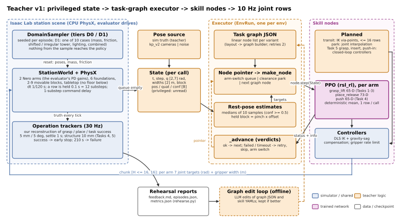
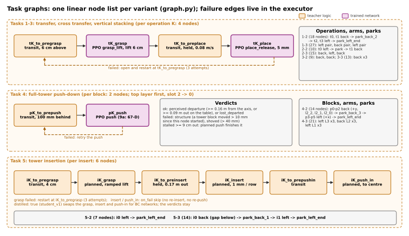
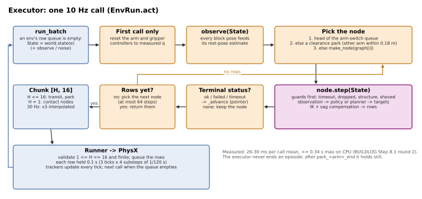
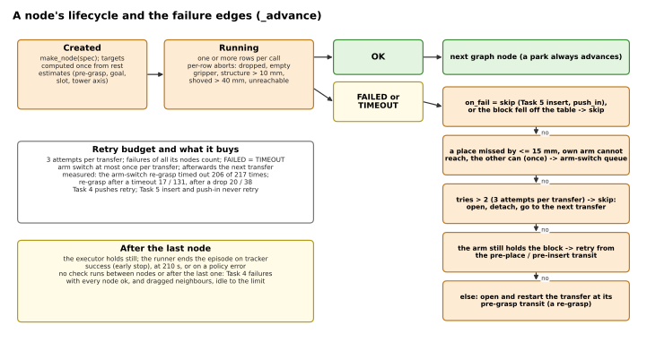
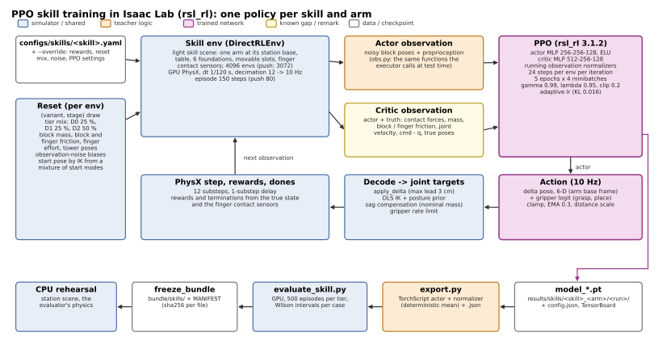

# Teacher v1: the privileged agentic teacher

*2026-10-24. This document describes the code in `~/Documents/tower_rl`: HEAD `f5e8cce` ("Pose estimator - v1") plus the uncommitted student and server work. It covers every component of the teacher and of the simulation layer it shares with the student: inputs and outputs, how each part is trained or set up, and how it connects to the others. The deployable system is in `Student-v1.MD`. The diagrams are SVGs in `figures/teacher-v1/`; `~/Documents/tower_rl/scripts/doc_figures.py` regenerates them.*

*Sources.*
- **Code** is cited as `file:line`, relative to `~/Documents/tower_rl`. A bare `executor.py` means `tower_rl/graph/executor.py`.
- **BL «…»** is a section of `BUILDLOG.md`.
- **Docs:**

  | Short name | File |
  |---|---|
  | Build file | `TOWER_BUILD_INSTRUCTIONS.md` |
  | Session 1 | `Teacher_build_session.MD` |
  | Session 2 | `Teacher_build_session_2.MD` |
  | PE | `Pose-estimator-v1.MD` |
  | PR1 | `Student-distillation-progress-1.MD` |

- **Doc vs code:** where a design doc and the code disagree, this document describes the code; §8 lists the differences.

---

## Contents

1. [What the teacher is](#1-what-the-teacher-is)
2. [The world it runs in: simulation, interface, tasks, scoring](#2-the-world-it-runs-in)
3. [The agentic layer: task graphs and the executor](#3-the-agentic-layer-task-graphs-and-the-executor)
4. [Skills](#4-skills)
5. [Tooling: rehearsal, tracing, reports](#5-tooling)
6. [What is privileged, and where](#6-what-is-privileged-and-where)
7. [Facts for the open design questions](#7-facts-for-the-open-design-questions)
8. [Docs vs code](#8-docs-vs-code)
9. [Appendix: file map](#9-appendix-file-map)

---

## 1. What the teacher is

The teacher is an **agentic, graph-structured controller**.

- **Graph.** Each task variant has a fixed, linear list of skill nodes, compiled from the variant's layout: transit, grasp, place, push, insert, push-in, park.
- **Executor.** A deterministic executor walks that list. Each 10 Hz call it:
  1. builds the current node from the State;
  2. steps it, which yields joint rows;
  3. judges the node's outcome when it ends;
  4. on failure, moves its pointer: retry, skip, arm switch.
- **Skill nodes.** Some are planned controllers (IK via-points, joint interpolation, closed-loop insertion). Others are **PPO policies trained in Isaac Lab**, one per skill and arm: grasp_lift, place_release, push.
- **Simulation.** Everything runs in our Isaac Lab copy of the evaluator's station. It uses the evaluator's drive parameters and CPU PhysX, exactly as the evaluator does.

**Where "privileged" actually lives.** In v1 it sits in four places, not in the skill networks:

1. **The executor's State.** In simulation mode its block poses are exact, every block is visible and every confidence is 1.0. This is the only privileged input the executor reads.
2. **The PPO critics.** They see mass, friction, contact forces, joint velocities and true relative poses. The actors see only camera-estimable inputs: noisy block poses and proprioception (`skills/obs.py:1-5`).
3. **The operation trackers.** They score grasps, places and task success from the simulator truth.
4. **The student's state oracle** (Student-v1.MD §3.3). It reads the trackers' truth to label decisions.

Because the actors are already non-privileged, the student reuses most teacher skills unchanged (Student-v1.MD §4).

*Figure 1. The teacher. The State comes from the simulator (or from a pose source standing in for perception). The executor turns it into a skill call; the skill's rows go through the controllers back into PhysX. Rehearsal reports feed an offline edit loop that edits the graphs.*

### 1.1 Results by pose source

Episodes are counted as successes over attempts; per-cell sample sizes are given in each row.

| Pose source | Run | Result | Source |
|---|---|---|---|
| Simulator truth | teacher_v4, Tasks 1-3, 100 per cell | 1186 / 1200 | BL «Step 7 acceptance» |
| Simulator truth | teacher_v6, Tasks 1-3 | 1182 / 1200 | BL «Step 8.1 round 2» |
| Simulator truth | Task 4, 40 per cell | 4-2: D0 39 / 40, D1 35 / 40 4-3: D0 36 / 40, D1 29 / 40 | BL «Night of 2026-10-20» |
| Simulator truth | Task 5, 24 per cell | 5-2: D0 24 / 24, D1 18 / 24 5-3: D0 24 / 24, D1 14 / 24 | same |
| Simulator truth | `teacher_t45_final`, all ten variants, seed 5000 | 446 / 480 | BL Status |
| Estimator noise v1 | Task 4: old pushes / 9a pushes, vs 84 privileged | 44 / 96 / 53 / 96 | BL «Results of the 08:00 queues» |
| Estimator noise v2 | four variants (gate G5) | 27 / 64, vs 47 / 64 in the camera loop (too harsh) | BL «G5 with the v2 refit» |
| **Camera loop, kp_v2** (the "camera teacher") | `teacher_t45_final`, seed 7000, 8 per tier | **131 / 160**: Tasks 1-3 94 / 96, Task 4 15 / 32, Task 5 22 / 32 | BL «Results of the 08:00 queues» |

Camera teacher per variant, as D0 / D1 successes out of 8:

| Tier | 1-2 | 1-3 | 2-2 | 2-3 | 3-2 | 3-3 | 4-2 | 4-3 | 5-2 | 5-3 |
|---|---|---|---|---|---|---|---|---|---|---|
| D0 | 8 | 8 | 8 | 8 | 8 | 8 | 5 | 4 | 8 | 7 |
| D1 | 8 | 7 | 8 | 8 | 8 | 7 | 4 | 2 | 4 | 3 |

### 1.2 Component index

| Layer | Component | Kind | Code | Set up / trained by |
|---|---|---|---|---|
| World | StationWorld, PhysX, cameras | Isaac Lab scene | `sim/station_scene.py`, `sim/assets.py` | evaluator drive readback (`configs/robot/nero.json`), layouts |
| World | DomainSampler | seeded sampler | `domain.py`, `configs/tiers.yaml` | the robustness cases from the docs; ranges partly our interpretation |
| World | Controllers, kinematics | analytic | `control.py`, `kinematics.py` | fitted to the evaluator's gains |
| World | Operation trackers, metrics | analytic | `eval/operations.py`, `eval/metrics.py` | our reconstruction of the unpublished scoring |
| World | Runner | loop | `eval/runner.py` | the challenge's chunk semantics |
| Agentic | Task graph builder | compiler | `graph/graph.py` | layouts (demo plans) |
| Agentic | Executor | interpreter | `graph/executor.py` | hand-written; graph edit loop |
| Agentic | Rest-pose estimates | robust filters | `graph/estimates.py` | thresholds tuned under Step 8.1 noise |
| Skills | transit, park | planned | `skills/transit.py`, `executor.py` | demo geometry |
| Skills | grasp_lift, place_release, push | PPO per arm | `skills/*_env.py`, `ppo_cfg.py` | rsl_rl on GPU skill scenes |
| Skills | Task 5 grasp, insert, push-in | planned closed loop | `executor.py` | hand-tuned; PPO versions exist, unused |
| Tools | rehearse.py, trace_episode.py, compare_runs.py | CLIs | `scripts/` | — |

---

## 2. The world it runs in

### 2.1 The official interface (`tower-infer-v1`)

Everything in the simulation layer imitates this interface: the submitted policy sees nothing else.

| | Content | Source |
|---|---|---|
| Observation | `joint_positions` float32 [2,7] rad (row 0 left, row 1 back) `gripper_widths_m` [2] `images`: 4 × uint8 [480,640,3]: `left_back_camera`, `right_front_camera` (static, in the dataset's JPEG orientation), `left_wrist_camera`, `back_wrist_camera` `sim_time_s`, `step_index`, `task_variant`, `instruction` | contract:111-136 |
| Not in the observation | block poses, depth, joint velocities, efforts or torques, contact or gripper forces, mass, friction, case id | `tower_protocol.py:87-97` |
| Action | little-endian float32 [H,16], 1 ≤ H ≤ 16. Each row is `[left j1..j7, left width, back j1..j7, back width]`, absolute rad and m, within ±6.2832 rad and [0, 0.10000000149] m. The evaluator **rejects** out-of-bounds chunks; it does not clip. | contract:140-174 |
| Timing | one row = 0.1 s = three 30 Hz ticks; simulated time pauses during inference; 210 s simulated per episode; 180 s per call; 7200 s wall per episode | `track.json` |
| Evaluation | 10 variants × 10 episodes; `policy_seed_mode` fixed; protocol `tower-robustness-v1`. Every variant uses the same ten frozen scene cases; the reset seed only drives the model's own sampling. | contract:182, 206 |

"contract" is the starter kit's `.agents/skills/tower-policy-adapter/references/contract.md`.

### 2.2 Physics and timing

- **Code:** `configs/physics.yaml:4-25`; `sim/assets.py:102-110`; `sim/station_scene.py:240-262`.
- **Clock:**
  - dt 1/120 s, 4 substeps per 30 Hz tick, 3 ticks per 10 Hz row: 12 physics steps per row.
  - Zero-order hold: a row is held unchanged for 0.1 s, with no interpolation.
  - Command delay: 1 substep (8.3 ms) per arm. The evaluator's values are 5 ms (left) and 10 ms (back).
- **Solver:** TGS. Robot 32 / 1 iterations, blocks 16 / 4, maximum depenetration 1 m/s, bounce threshold 0.2.
- **Units:** metres. The station is authored in mm and wrapped at scale 0.001.
- **CPU, as in the evaluator.** On CPU TGS, 10 of 10 Task 2-2 replays end with every block within 0.89 mm of the recording. On GPU TGS the keel-hulled blocks creep 8-19 mm (BL «Step 2»). Training uses the GPU; every acceptance number in this document is from CPU rehearsal.
- **Limits:**
  - Holding a row for 0.1 s excites the soft arm: the demos replayed at 10 Hz drop blocks (BL «Step 3»).
  - Whether the evaluator interpolates within a row is unknown.

### 2.3 Robot, blocks, and the open finger-effort question

- **Code:** `sim/assets.py:23-99`, `configs/robot/nero.json`.
- **Arms:** 10 DOFs each: 7 revolute joints, a passive `gripper` slider (stiffness 0), and two fingers driven to ±w/2.
- **Drives:** the evaluator's runtime readback, converted to SI.

  | Joint group | kp | Other |
  |---|---|---|
  | Left arm | [75, 4815, 2709, 2085, 225, 153, 162] N·m/rad | per-joint kd, armature, static / dynamic / viscous friction; effort 100 N·m; 5 rad/s |
  | Back arm | [63, 767, 13184, 68, 4088, 139, 795] N·m/rad | same |
  | Fingers | 800 N/m | kd 20; 1.5 m/s |

  The gains are soft: at rest, back j4 sags 0.085 rad, which is 2-4 cm at the pinch (BL «Robot model findings»). The controllers compensate for this (§2.7).
- **Blocks:**
  - The station's Foundation01 hull: 0.15 × 0.0497 × 0.0283 m plus keel points, 0.1056 kg.
  - Block material "Wood": friction 0.40 / 0.23, restitution 0.02. The finger material is 2.4 / 2.0. Both use average friction combine.
  - Task 5 side blocks are 32 mm wide and weigh 0.11264 kg; Task 5-3 uses cuboid colliders.
- **Finger effort (organizer question Q2, open):**
  - Every scene descriptor says 3 N; the Tasks 1-3 dataset readback says 22 N. We use 22 N for Tasks 1-3 and 3 N for Tasks 4-5.
  - Per-finger normal force ≈ min(800 N/m × penetration, the effort limit). On the 49.7 mm block:

    | Closed width | Force per finger |
    |---|---|
    | 0.040 m | ≈ 3.9 N, which saturates at a 3 N limit |
    | 0.0425 m | ≈ 2.9 N |
    | 0.044 m | 2.4 N |

  - Teacher grip check (Tasks 1-3, out of 288): 22 N / 0.040 → 282; 3 N / 0.040 → 271; 3 N / 0.0425 → 276; 22 N / 0.0425 → 273 (BL «Step 0.3»).
  - Neither the effort nor the force is observable; only the width is.

### 2.4 Station scene, StationWorld and State

- **Code:** `sim/station_scene.py:78-110` (scene config), `:113-295` (`StationWorld`); `graph/interface.py:19-35` (`State`).
- **Scene:**
  - The station wrapper with a tabletop collider: x 0..0.96, y -0.66..0, top at z = 0. There is **no floor below the table**, nor in the organizers' station.
  - Both installed arms: left base at (-0.1165, -0.288, 0), yaw 180°; back base at (0.381, -0.774, 0), yaw -90°.
  - Blocks: 6 kinematic foundations first, then the movable blocks by layer. Four evaluator cameras (when rendering) and one RectLight per env.
- **`reset(dom, stage)`** (`:186-215`):
  - foundations at their nominal poses;
  - the source tower sampled from the domain sample;
  - mass, inertia and friction applied to movable blocks only;
  - arms at home;
  - 1 s settle, after which t = 0.
- **`state(env)` → `State`** (`:288-295`):

  | Field | Shape, units |
  |---|---|
  | `t`, `step` | simulated time, row count |
  | `variant`, `instruction` | the runner passes `""` for the instruction |
  | `q` | [2,7] rad, measured |
  | `width` | [2] m: finger 1 − finger 2 |
  | `block_ids`, `block_pos`, `block_quat` | [B], [B,3] m in the station frame, [B,4] wxyz |
  | `block_conf` | [B], 1.0 on truth |
  | `privileged` | `{block_speed}`, plus what the runner adds (§2.9) |

- **What the scene has but State does not carry:** joint velocities, block velocity vectors, masses, frictions. The station scene has no contact sensors.
- **Limits:**
  - Finger friction is fixed at 2.4 / 2.0 here, not randomized. The data station replays best with 1.2 / 1.0.
  - Task 4 outcomes are nearly independent between two processes (PhysX history).

### 2.5 Tasks and layouts

- **Code:** `data/layouts.py:93-363`, `scripts/build_layouts.py`, `tower.py:31-170`.
- **Layout data:** `configs/layouts/*.yaml`, generated from 531 dataset episodes ("do not edit"). Plans (order and arm) come from the demos' `target_mapping`, the same plan in every episode.

| Variants | Scene | Plan, arms |
|---|---|---|
| 1-2, 1-3 transfer | tower on pad A → pad B, two blocks per layer | 1-2: L2 back, L1 left 1-3: L3 left, L2 back, L1 left |
| 2-2, 2-3 cross transfer | A → B, one centre block per layer | 2-2: L2 left, L1 back 2-3: L3 back, L2 left, L1 back |
| 3-2, 3-3 vertical stacking | B → A, aligned column | back arm only |
| 4-2, 4-3 push-down | full layers of 3 on A; push every block off, top layer first, slot 2 → 0 | 4-2: L2 back (+y), L1 left (+x) 4-3: L3 left, L2 back, L1 left |
| 5-2, 5-3 insertion | insert blocks from B into the tower on A (32 mm side blocks, empty middle slot, 3-block roof) | 5-2: one insert, left 5-3: L2 back, then L1 left |

- **Rest heights:** 0.015, 0.0441, 0.0731 and 0.1021 m per layer.
- **Sampling:** per-block jitter, layer shift and yaw, and assembly shift and yaw about the source-pad centre. Task 4 has no per-block jitter; in Task 5 only the source blocks move.

### 2.6 Domain randomization (tiers D0 / D1 / D2)

- **Code:** `domain.py:17-110`, `configs/tiers.yaml:1-44`. Applied at reset (`station_scene.py:157-215`) and to the lights (`sim/lights.py`).
- **D0 (nominal):** assembly ±3 mm, per block ±2 mm.
- **D1:** each episode draws one of the ten cases. Ranges are uniform, given as ±value or [lo, hi].

| Case | Randomization |
|---|---|
| nominal | D0 |
| lightweight | mass × [0.4, 0.7], one multiplier for all movable blocks |
| heavy | mass × [1.4, 2.0], shared |
| uneven_weights | mass × [0.4, 2.0], per block |
| slippery | static friction [0.15, 0.30], dynamic [0.07, 0.14], shared |
| high_friction | static [0.9, 1.3], dynamic [0.5, 0.8] |
| shifted_assembly | ±15 mm per axis, ±10° |
| irregular_layers | ±8 mm, ±5° per layer |
| lighting | intensity × [0.25, 2.0], [3000, 8500] K, azimuth ±60° |
| combined | mass × [0.5, 1.8] per block; each block slippery or high-friction at 50 / 50; ±10 mm / ±8°; light × [0.4, 1.6] |

- **D2 (skill training only):** per-block mass × 0.35-2.2, static friction 0.13-1.4, dynamic 0.06-0.9, assembly 18 mm / 12°, layers 10 mm / 6°.
- **Finger friction (training only):** static U(1.0, 2.6), dynamic = static × U(0.8, 0.85).
- **What is documented vs ours.** The case names, their ranges and the list of fixed items come from the docs (BL «Ground truth re-checked»). The following are our interpretation:
  - uniform distributions;
  - shared vs per-block draws;
  - the mixed-friction rule;
  - the light rotation centre;
  - applying mass and friction to Task 5's tower blocks.

  The official case values are frozen and unpublished.
- **Seeding:** one generator per batch. Batch b uses seed + 100 b, and an episode's seed is batch seed × 1000 + env. A sample therefore depends on (seed, num_envs, tier). D1 draws cases with replacement; `--case` forces them.
- **Reaches the policy?** No. `Policy.reset` receives only the variant and the seeds (`runner.py:139`).

### 2.7 Kinematics and controllers: how a command becomes joint targets

- **Code:**
  - `kinematics.py:41-257`: batched FK, Jacobian, DLS IK, gravity model;
  - `control.py:24-118` (`ArmController`), `:121-154` (`GripperController`);
  - `grasp.py`, `push.py`, `postures.py`: canonical pose geometry.
- **TCP:** the *pinch*, gripper_base × (0, 0, 0.178 m). z is the approach axis and y the jaw axis. `link7` matches the recorded `observations/eef` to < 0.01 mm.
- **Arm controller, per 10 Hz row:**
  1. Move the Cartesian pinch target by the requested delta, clipped to at most `max_lead` from the measured pinch.
  2. Run 4 DLS IK iterations, seeded with the previous solution, null-space gain 0.05 toward a demo posture prior, limit margin 0.03 rad.
  3. Clamp each joint step to 0.15 rad per row.
  4. Apply gravity-sag compensation: `q_cmd = q_des − τ_g(q_des, payload) / kp`.
  - **Payload:** the nominal 0.1056 kg while holding. The true block mass is never used ("the real block mass is unknown at test time", `control.py:35`).
  - **Accuracy:** τ_g matches PhysX within 0.1-2 % per joint. The residual sag is ≤ 0.2 mrad (left) and ~7 mrad (back j4, from joint friction).
- **Gripper controller:**
  - Rate-limited width: closing at 0.3 m/s above 0.06 m and 0.1 m/s below; opening at 0.3 m/s.
  - Closed width 0.040 m by default. The graphs override it: 0.0438 for Task 4 and 0.0425 for Task 5.
  - The Task 4 push tool holds the fingers at width 0; the push-in tool at 0.02 m.
- **Pose geometry (from the demos):**
  - **Grasp:** jaw across the 0.05 m width, pinch at the block centre + 0.5 mm, approach tilted 12° (left) or 5.5° (back).
  - **Via-points:** pre-grasp 6 cm, post-lift 6 cm, pre-place 5 cm, release 5 mm.
  - **Push:** closed fingers 100 mm behind the block centre (first contact at 86.5 mm), 7-16 mm above it, tilted 45° (left) or 30° (back).
  - **Departure:** block centre ≥ 0.16 m from the tower axis, or flat on the table and ≥ 0.09 m out.

### 2.8 Operation trackers and metrics (our reconstruction of the scoring)

- **Code:** `eval/operations.py:28-251` (`OpCfg`, `OperationTracker`), `:254-409` (`PushTracker`); `eval/metrics.py:20-82`.
- **Inputs, every 30 Hz tick:** true block poses and speeds, both pinches, closed flags (measured width < 0.055 m).
- **Outputs:**
  - the episode's success flag (which triggers early stop);
  - latched grasp-ok and place-ok per operation;
  - disturbance windows and events;
  - `instant` / `latched` / `disturbed_so_far` for the student's labels.

| Task | Grasp ok (G) | Place ok (P) / success |
|---|---|---|
| Transfer, insertion | the target is ≥ 2 cm above its start while a closed pinch is within 3 cm of it | P: released, static (< 0.01 m/s) and within 5 mm xy / 10 mm z / 5° yaw for 1 s, with lower-layer goals still in tolerance Success: every G and P latched, every goal in tolerance, everything static, nothing held, and (Task 5) the side and roof blocks intact, all held for the settle time |
| Push-down | all earlier pushes done, and the target moved ≥ 2 cm along its push direction | P: the block is off the tower and static for 1 s Failure: an out-of-order departure, or a remaining tower block that moves > 10 mm, tilts or drops |

- **Tasks 4 and 5:** final settle 2 s, structure limit 10 mm, collapse at 30° tilt or 15 mm drop.
- **Metrics:** counts are summed over episodes, then divided.

  | Metric | Definition |
  |---|---|
  | TSR | successful episodes / episodes |
  | GSR | successful grasps / planned grasps |
  | PSR | successful places / planned places |
  | LHPR | (G + P) successes / planned (G + P) |
  | ODR | disturbed non-target block occurrences / (G + P + 1 − success) |

  Wilson 95 % intervals are attached. The implementation reproduces the docs' worked example (BL «Step 3»).
- **Limits:**
  - The tolerances, the structure rule and the evaluator's early-stop rule are assumptions (open organizer questions Q3 and Q4).
  - A block that falls off the floorless table never becomes static, so such an episode always runs to 210 s.

### 2.9 Runner (`run_batch`)

- **Code:** `eval/runner.py:103-232`.
- **Episode setup:** reset the world, reset the trackers on the settled poses, then `policy.reset(n, variant, seeds)`.
- **Loop:**
  1. For every env with an empty row queue: `state` → `with_truth` → optional `observe` (cameras + estimator) → optional noise → `act`.
  2. The returned chunk is validated (1 ≤ H ≤ 16, finite) and queued.
  3. Each env pops one row, and `apply_row` holds it for 3 ticks.
  4. The trackers update every tick.
- **Episode end:** tracker success (early stop), 210 s, or a policy exception or bad chunk (scored as a failure).
- **What `privileged` gains here** (`:174-190`): the trackers' `ops`, `ops_own`, `ops_latched` and `disturbed`. Camera and noise modes add `true_block_pos` / `true_block_quat`. **The executor reads none of these.**
- **Recorded:** `EpisodeOutcome` with events, disturbed ids, case, seed, wall time, minimum arm gap, call timings and the policy log, written to `episodes.json`.
- **Limit:** chunks are not bounds-checked here, unlike the official evaluator; the student's adapter clips.

---

## 3. The agentic layer: task graphs and the executor

### 3.1 What the executor sees

The executor reads only these State fields:

| Field | Use |
|---|---|
| `q` | FK pinch, controller reset, IK seeds, actor observations |
| `width` | holding / gripping / dropped tests |
| `t` | node timeouts, event times |
| `block_pos` / `block_quat` / `block_conf` | everything else; samples with conf < 0.5 are ignored by the rest-pose estimates |

It never reads `State.privileged` (checked by grep). In simulation mode the poses are exact and the confidence is 1 for every block, including occluded ones; that is the teacher's only privileged input. The typed `SkillCall` / `SkillResult` classes in `interface.py` are unused: a node is a dict from the graph JSON, and its result is `(Status, info)`.

### 3.2 Task graphs

- **Code:** `graph/graph.py`: transfer `:59-93`, push-down `:26-56`, insertion `:140-193`, validation `:96-107`.
- **Graph files:** `tower_rl/graph/graphs/`; bundles carry copies.
- **Building:**
  - Each operation k becomes a fixed chain of nodes.
  - `park_<previous arm>_<k>` is inserted when the arm changes; `park_<arm>_end` closes the graph.
  - Edges are implicit: ok goes to the next node, and all failure handling is in the executor.
  - There is no dependency graph. Order alone encodes the dependencies (top layer first).
- **JSON, top level:**
  - all variants: `variant, version, retries 2, rate_hz 10, chunk {transit 16, contact 1}, nodes[], foundation{destination, source, destination_yaw_deg}, movable[]`;
  - Task 4 adds `family pushdown`, `gripper_closed_width 0.0438`, `tower`;
  - Task 5 adds `family insertion`, `gripper_closed_width 0.0425`, `grasp_planned true`, `tower{structure}`;
  - the Tasks 1-3 files are version 5 and carry `perception{jaw_to_goal 0.5}`.
- **JSON, per node:** `id, skill, arm, transfer, block, target, first_of_transfer, timeout_s, tol_*`, plus skill fields and the optional `on_fail ∈ {retry, skip, skip_if_close}`, `held`, `v_max_held`, `inject`, `planned`, `distilled`, `pushin_kin`.

*Figure 2. The three graph shapes. Transfer: 4 nodes per operation. Push-down: 2 per block. Insertion: 6 per insert. The dashed edges are the executor's failure edges (§3.6).*

| Family | Node | Skill | Key fields | Timeout |
|---|---|---|---|---|
| Transfer | `tK_to_pregrasp` | transit | 6 cm above, tol 3 cm / 5° | 15 s |
| Transfer | `tK_grasp` | grasp_lift (PPO) | lift 6 cm | 15 s |
| Transfer | `tK_to_preplace` | transit, held | 5 cm above the goal, 0.08 m/s | 20 s |
| Transfer | `tK_place` | place_release (PPO) | release 5 mm, tol 5 mm / 5°, settle 1 s | 20 s |
| Push-down | `pK_to_prepush` | transit | 100 mm behind, tol 2 cm / 5° | 15 s |
| Push-down | `pK_push` | push (PPO) | structure 10 mm | 12 s |
| Insertion | `iK_to_pregrasp` | transit | 4 cm above | 15 s |
| Insertion | `iK_grasp` | grasp (planned) | lift 6 cm, ramp 0.04 m/s at 0.1 m/s² | 15 s |
| Insertion | `iK_to_preinsert` | transit, held | 0.17 m out on the slot axis, tol 1 cm / 3°, 0.06 m/s | 25 s |
| Insertion | `iK_insert` | insert (planned) | entry lift 0 (5-2) / 1 mm (5-3), on_fail skip | 30 s |
| Insertion | `iK_to_prepushin` | transit | tol 1 cm / 3° | 15 s |
| Insertion | `iK_push_in` | push_in (planned) | tol 4 mm, on_fail skip, gap_below | 20 s |
| All | `park_<arm>_<k>`, `park_<arm>_end` | park | — | 12 s |

Graph sizes: 1-2: 18 nodes, 1-3: 27, 2-2: 10, 2-3: 15, 3-2: 9, 3-3: 13, 4-2: 14, 4-3: 21, 5-2: 7, 5-3: 14.

### 3.3 The executor: one 10 Hz call

- **Code:** `Executor` `executor.py:79-124`; `EnvRun` `:128-466` (`act` `:310-341`, `row` `:166-171`).
- **Inputs:** one State per requesting env, plus the bundle's skills `skills/<skill>_<arm>.pt` (TorchScript actors; `obs_dim` from the sidecar JSON).
- **Output:** float32 [H,16]. Per arm: 7 sag-compensated absolute joint targets (rad) and a gripper width (m).
  - H ≤ 16 for transits and parks (open loop).
  - H = 1 for every contact node and for a transit waiting to arrive.
  - On the 30 Hz track, contact rows are expanded to 3 interpolated rows.
  - After the last node, one hold row.

*Figure 3. One call. Up to 64 node steps run until some node emits rows. A node that ends hands its status to `_advance`, which moves the pointer.*

- **Each call:**
  1. On the first call, reset the controllers and grippers to the measured state.
  2. `observe`: feed every block pose into its rest-pose estimate (§3.7).
  3. Pick the node: the arm-switch queue head, else a clearance park, else `make_node(graph[i])`.
  4. Step it; on a terminal status, call `_advance`.
  5. Repeat until rows exist.
- **Speed:** 26-30 ms per call on average and ≤ 0.34 s at most on the CPU (BL «Step 8.1 round 2»).
- **Episode end:** the executor never ends an episode. After `park_<arm>_end` it holds still.

### 3.4 Scheduling and two-arm coordination

- **Order:** strictly serial, one node at a time in graph order. The arm is the node's `arm`, and the idle arm repeats its last command; nothing moves both arms at once.
- **Clearance:**
  - structural parks in the graph;
  - `_clearance_park` (`:352-369`): before every graph transit, if the other arm's pinch is within 0.18 m (xy) of the target, an `auto_park_<other>` (10 s) is inserted;
  - the arm-switch sequence's own parks.
  - A park opens the gripper, detaches any block, and lasts at least 5 rows.
- **Known pathologies:**
  - **Clearance-park livelock.** An arm already at home is parked again whenever the next target lies within 0.18 m of its home pinch, every 0.5 s until 210 s. It occurred in 54 of 7,909 logged episodes, all of them failures. The executor was left unchanged; the student runtime has a guard (BL «Step 2: option runtime»).
  - **Near collisions.** 13 of 2,400 acceptance episodes brought the arms within 10 cm (closest 2.6 cm), all failures; 10 were on the arm-switch path.
  - **Parks never time out.** `ParkNode` never checks its timeout, so the "timed-out park" edge cannot fire.

### 3.5 Node types and their verdicts

Every verdict is computed on the State's block poses: truth in simulation mode, perceived otherwise.

| Node | OK when | Failed / timeout | Info logged |
|---|---|---|---|
| transit (`:526-630`) | pinch within the node's tolerance of the reachable via-point, after the plan and a 0.4 s settle | timeout; "pregrasp unreachable" (adjustment > 30 mm or 10°); held transit "dropped" (width < 44 mm) | pos/rot error, `max_block_disp_mm` (all other blocks; **logged only**) |
| park (`:706-735`) | after n rows | never | — |
| grasp_lift, PPO (`:797-884`) | held (closed, width 44-56 mm) and risen ≥ 6 cm | "dropped" (risen ≥ 2 cm, now < 1 cm and not held); timeout 15 s / 150 steps | lift, grasp offset, grasp rotation (logged, not gated) |
| grasp, planned (`:738-794`) | grasped and lifted | "empty gripper" (width < 44 mm during the lift) | same |
| place_release, PPO (`:985-1083`) | released, open, pinch ≥ 3 cm up, at rest (window-median drift < 2.5 mm) or ≥ 30 rows; then the median of the last 10 perceived poses is within 5 mm xy, 5° yaw, 10 mm z | out of tolerance; timeout 20 s / 150 steps | `place_xy_mm`, `yaw_deg` |
| push, PPO (`:1086-1235`) | perceived departure, then a 5-row retreat; or "lost_departed" (target unseen > 15 rows after last seen ≥ 60 mm along) | "structure": a tower block moved > 10 mm **since this node started**; "shoved" (lateral > 40 mm); timeout 12 s / 80 steps | along, lateral, moved, hand-over |
| insert, planned (`:1242-1395`) | after the slide, open and retreat: within 15 mm of the entry depth and < 4 mm lateral | "structure" (side / roof blocks > 10 mm); "slide stalled" (> 400 rows); timeout 30 s | along, lateral, moved |
| push_in, planned (`:1398-1565`) | after the push and retreat: xy ≤ 4 mm and yaw ≤ 5°; with `pushin_kin`, depth only | "structure" (> 10 mm); out of tolerance; timeout 20 s | `place_xy_mm`, yaw, moved, `kin_along_mm` |

**In-node behaviours:**
- **Push hold** (65-D push policies only): while the target is unseen, the pusher holds for ≤ 15 rows.
- **Push hand-over:** a push whose block stalls ≥ 9 cm out, level and static for 3 rows is finished by a planned straight push.
- **Planned insert:** re-aims every row from the perceived block. It advances only while aligned within 0.8 mm lateral, 0.6 mm height, 0.4° yaw and 0.3° pitch.
- **Planned push-in:** slows down near the end, holds and nudges ≤ 6 mm when the block is static and short, and slides the pusher down the end face across the empty gap below the 5-3 layer-2 slot.

### 3.6 Failure edges, retries and recovery (`_advance`)

*Figure 4. What happens after a node ends. FAILED and TIMEOUT are handled the same way. The rules are tried in order.*

- **Code:** `_advance` `:404-466`, `_schedule_arm_switch` `:371-392`, `_pregrasp_reachable` `:394-402`.
- **Rules, in order:**
  1. An inserted clearance park is logged and the pointer stays.
  2. An arm-switch node is popped from its queue. If a non-park alt node fails, the rest of the queue is dropped except its parks. When the queue empties, the pointer jumps to the next transfer.
  3. A graph node that ends ok advances to the next node; so does any park, ok or not.
  4. Otherwise the node's `on_fail` applies (default `retry`):
     - **Skip conditions:** `skip`, or a block that fell off the table (z < −0.02), skips the operation.
     - **Arm switch first:** a failed **place** tries the arm switch first. It fires at most once per transfer, when the miss is ≤ 15 mm, the own arm cannot reach the pre-grasp and the other arm can. Its queue is park, then the transfer with the arm swapped, then park.
     - **Retry budget:** `tries[k] += 1`. Once tries > 2 (3 attempts per transfer, counting failures of all its nodes), the operation is skipped: open, detach, and move on to the next transfer.
     - **Still holding:** if the arm still holds the block, the operation is retried from the pre-place or pre-insert transit.
     - **Otherwise:** open the gripper and restart the transfer at its pre-grasp transit, a re-grasp (from the destination stack, if the place failed).
- **Per task:** Task 4 pushes retry. Task 5 insert and push-in are `on_fail: skip`, so there is no re-insert and no re-push.
- **Measured value of the recovery edges** (BL «G3b, first run»):
  - the arm-switch re-grasp timed out 206 times in 217 attempts, and 205 of 211 episodes with an arm switch failed;
  - grasp retries succeed 17 / 131 after a timeout and 20 / 38 after a drop;
  - under noise, retries push mean Task 1-3 episodes to 187-201 s of the 210 s budget (Session 1 §10.9).
- **Termination:** after the last node the executor holds still. The runner ends the episode on tracker success, at 210 s, or on a policy error, so **every failed episode runs to 210 s**.

### 3.7 Robust pose estimates and checkpoint predicates

- **Code:** `graph/estimates.py`; `executor.py:180-307`.
- **`StaticPose`** (`estimates.py:46-80`): the median of the last 10 samples (30 for foundations), gated at 4 mm. Two consecutive far samples mean the block moved. Samples below conf 0.5 are ignored.
  - `block_rest` supplies every target that is computed once: pre-grasps, goals, the slot, `arm_clear`, reachability, and the reference poses for the disturbance checks.
- **`PoseWindow`** (`:83-108`): up to 40 samples; median and drift between windows. The place verdict's at-rest test uses it.
- **Goals:**
  - `dest_goal` (`executor.py:252-285`): the pad centre is the mean of the three destination foundations, the pad yaw comes from the line through foundations 0 and 2, plus the layout's in-pad offset.
  - `slot_pose` (`:287-307`): the midpoint and axis of the two side blocks.
- **Held blocks:** `attach` / `block_est` / `refresh_attached` track a held block as pinch × offset, with refresh gain 0.3, a 5 mm gate, and 3 agreeing samples to accept a slip.
- **Checkpoint predicates** (`graph/checkpoints.py`): `holding`, `gripping` (width within 2.5 mm of 49.7 mm), `grasped`, `placement_error`, `arm_clear` (0.18 m). `placed`, `static` and `max_disturbance_m` are defined but never called.
- **Evidence they help** (BL «Step 8.1 round 2», «Step 8.1 preview»): under noise, false place failures fell from 11 / 30 to 1 / 27 (Task 3-3), and attach/detach took the dropout case from TSR 0.375 to 0.875.

### 3.8 Flags

| Flag | Where | Effect | Status |
|---|---|---|---|
| `distilled` | graph top level (`executor.py:478-484`) | replaces the Task 5 planned grasp, insert and push-in with BC networks when the bundle has them | set in all ten `student_v1` graphs; changes only Task 5 |
| `pushin_kin` | graph / node (`:1465-1480`) | push-in depth = max(perceived, pinch along − 86 mm); judges depth only | off. Sim poses: 78 → 83 / 96; camera loop: 14 vs 21 / 32 |
| `grasp_planned` | graph | planned grasp instead of PPO | on for Task 5 |
| `gripper_closed_width` | graph | closed width | 0.0438 (Task 4), 0.0425 (Task 5) |
| `perception.jaw_to_goal` | graph | shifts the place goal by 0.5 × the held block's perceived jaw-axis offset | Tasks 1-3 |
| `on_fail`, `skip_if_close_m`, `planned`, `inject`, speed limits, `gap_below` | node | per node | `inject` is written by the student's data collection |

`keep_delivered` is not an executor flag; it exists only in the student runtime.

### 3.9 Pose sources and the camera teacher

The same executor runs on three kinds of pose source (`run_batch(observe=…)`, `rehearse.py`):

| Source | Flag | What replaces the poses |
|---|---|---|
| Simulator truth | (none) | nothing: exact poses at conf 1 |
| Provisional noise (Step 8.1) | `--perception_noise` | per-episode bias 3 mm / 3°, jitter 1 mm / 0.5°, 2 % dropouts, 0.5 % 1 cm outliers |
| Estimator noise model | `--est_noise <yaml>` | recorded kp_v2 error traces, replayed by block class (v1, v2; Student-v1.MD §2.6) |
| Camera loop | `--perception <checkpoint>` | `CameraPerception`: renders the four cameras with 4 RTX subframes, runs kp_v2 once for all requesting envs, then a per-env `PoseEstimator` with `focus = focus_block(e)`. Joints and widths pass through unchanged |

The executor's adaptations to estimated poses:
- the rest-pose medians and attach logic (§3.7);
- the push hold and `lost_departed`;
- `jaw_to_goal`;
- the 67-D "seen" pushes (9a), which are in `teacher_t45_push9a` and the student; `teacher_t45_final` has the 65-D ones.

Results are in §1.1. `scripts/try_student.py --teacher --poses camera|sim|noise` runs the teacher in any of these modes.

### 3.10 Graph edit loop (offline)

- **Code:** `tower_rl/graph/edits/README.md`.
- **Edits allowed:** bounded LLM edits of graph JSON and skill YAMLs, driven by `feedback.md`. At most 5 edits per iteration and 10 iterations; an edit is kept only if it beats the Wilson interval on the same seeds. The executor code is never edited by the loop.
- **Iterations run:** three, all on 2026-10-19:
  1. near-miss places skip instead of retrying: reverted;
  2. held-transit speed 0.12 → 0.08 m/s: kept (Task 1-3 D1 0.833 → 1.000);
  3. `jaw_to_goal` 0.5: kept.
- **Tasks 4 and 5:** their graph fields were set by hand.

---

## 4. Skills

### 4.1 Summary

| Skill (node) | Kind | Actor obs (critic) | Action | Trained / built | Result (source) | Checkpoint in `teacher_t45_final` |
|---|---|---|---|---|---|---|
| transit | planned IK + quintic via-points | — | ≤ 16 rows per call, open loop | scripted | arrival 0.5-4.5 mm | — |
| park | planned joint interpolation | — | ≤ 16 rows | scripted | — | — |
| grasp_lift (Tasks 1-3) | PPO, per arm | 65 (141) | 7: Δpos 3 + Δrot 3 + gripper logit | rsl_rl, 4096 envs | left D0 100 % / D1 98.8 %; back 99.2 / 100 % | left `v5n_noise`, back `v3n_noise` |
| grasp (Task 5) | planned | — | target steps + close | scripted | see insert | — |
| place_release | PPO, per arm | 73 (151) | 7 | rsl_rl, 4096 envs | left 92.6 / 92.2 % (noisy obs), 99.6 / 99.0 % (exact); back 87.2 / 84.8 %, 99.8 / 100 % | left `v1` iteration 400, back `v1_scratch` |
| push (Task 4) | PPO, per arm | 65 (159); 9a: 67 (161) | 6: Δpos + Δrot, fingers closed | rsl_rl, 3072 envs | left v3 98.4 / 96.6 %, back v1c 99.6 / 94.6 % | left `v3`, back `v1c` (9a in `teacher_t45_push9a`) |
| insert (Task 5) | **planned closed loop** (a PPO env exists) | PPO: 55 (155) | 7 | PPO left only | PPO: 27 % on GPU, 0 / 32 on CPU, unused | none (planned) |
| push_in (Task 5) | **planned** (a PPO env exists) | PPO: 55 (155) | 6 | PPO left v1 | PPO CPU 43 / 64 vs planned 59 / 64, unused | none (planned) |

Skill results are per-skill GPU evaluations (500 episodes per tier) unless noted. The checkpoint paths are under `results/skills/<skill>_<arm>/`.

### 4.2 The PPO machinery shared by every learned skill

*Figure 5. Training a skill. The actor branch builds its observation with the same functions (`skills/obs.py`, `skills/task5_obs.py`) that the executor calls at test time; the critic branch adds the truth and the dynamics.*

**Environment** (`skills/base_env.py:73`, `sim/skill_scene.py`)
- `SkillEnvBase(DirectRLEnv)` on a light GPU scene: one arm at its station base pose, the table (friction 0.5 / 0.4), a parking shelf, 6 kinematic foundations and movable slots m0-m5 (Tasks 1-3) or m0-m8 (Tasks 4-5). Unused slots are parked at x = 1.35 m.
- One contact sensor per finger, filtered to the movable blocks.
- No cameras and no station mesh, so lighting has no effect here. Envs do not collide with each other.
- At most 3072 envs when an env has 15 blocks (PhysX's 64K-material limit).

**Timing.** dt 1/120 s, decimation 12, so one 10 Hz action every 0.1 s with the evaluator's 1-substep delay. Episodes end on the env's own termination or `time_out`; `learn(init_at_random_ep_len=True)`.

**From action to joints** (`base_env.py:346-362`)
1. Clamp to [-1, 1].
2. EMA `0.3·a + 0.7·ema` on the 6 motion channels.
3. Δpos = ema[:3] × scale(d) m, where scale(d) interpolates linearly between `pos_near` and `pos_far` over a skill-specific distance; Δrot = ema[3:6] × `rot_rad`. Both are in the **arm's base frame**.
4. `ArmController.apply_delta`, clipped to `max_lead` from the measured pinch; IK, posture prior, step limit and sag compensation as in §2.7.
5. Channel 7 (grasp, place) is a gripper logit compared with `grip_threshold`; the gripper is then rate-limited.

**Domain randomization at reset** (`base_env.py:253-312`)
- Tier mix: D0 25 %, D1 25 %, D2 50 % (§2.6).
- Mass and inertia scaled per block.
- **Block friction is one value pair per env** (the draw for block 0 is copied to every slot, `base_env.py:237, 286`), so the combined case's per-block mixed friction never appears in skill training.
- Finger friction U(1.0, 2.6).
- Finger effort: 22 N (Tasks 1-3 envs) or 3 N (Tasks 4-5). The 9b option draws {3, 22} N per env, unobserved.

**Observation noise, actor only** (`base_env.py:159-188`): a per-episode position bias (z halved) and yaw bias, plus per-step jitter, about yaw only; optional dropouts (pose frozen) and outliers.

**Observation encoding**
- Raw SI values, normalized by rsl_rl's running mean / variance normalizers.
- Poses are in the arm base frame, with orientations as "rot6d" (the first two rotation-matrix columns).
- Block half-turn symmetry is handled by a sign-canonical x axis and cos / sin of 2·Δyaw.
- **Asymmetric actor-critic:** each critic is the actor's observation plus privileged truth.

**PPO** (`ppo_cfg.py:8-28`; rsl_rl_lib 3.1.2 through isaaclab_rl 0.4.6)

| Setting | Value |
|---|---|
| Actor MLP | 256-256-128, ELU |
| Critic MLP | 512-256-128, ELU |
| Rollout | 24 steps per env per iteration |
| Updates | 5 epochs × 4 minibatches |
| Learning rate | adaptive, desired KL 0.016; per-skill initial lr (below) |
| Discounting | γ 0.99, λ 0.95 |
| Clipping | clip 0.2, clipped value loss with coefficient 1.0, max gradient norm 1.0 |
| Checkpoints | every 100 iterations, plus `model_final.pt` and `config.json` |
| Throughput | ≈ 12.4k env-steps/s at 4096 envs (≈ 8 s per iteration of 98,304 steps); 7.5-9.2k at 3072 |

**Export** (`skills/export.py:20-65`)
- TorchScript `FrozenActor` = actor normalizer + actor MLP, outputting the deterministic mean. It is checked against rsl_rl's inference to 1e-5.
- A `<name>.json` sidecar holds `{checkpoint, obs_dim, skill YAML}`.
- `freeze_bundle.py` copies the skills into `bundle/skills/`, records sha256 hashes in `MANIFEST.json`, and lists missing skills as `planned_fallbacks`.
- At run time the action parameters come from `configs/skills/<skill>.yaml` of the bundle (`TOWER_CONFIG_DIR`), not from the sidecar.

**Evaluation and probes**
- `evaluate_skill.py`: GPU, one tier per process, the exported actor, Wilson intervals per case.
- Privileged scripted oracles through the same action interface: `oracle_skill.py`, `oracle_push.py`, `oracle_task5.py`.
- CPU physics probes: `grip_capacity.py`, `release_test.py`, `drop_test.py`.

### 4.3 transit

- **Role:** move one arm to the next skill's start region. Planned; `skills/transit.py:25-114`, node `executor.py:526-630`.
- **Inputs:** the controller's current target (the start). The goal is computed once from rest estimates:

  | Goal | Pose |
  |---|---|
  | pregrasp | canonical grasp + 6 cm (Task 5: 4 cm), with a feasible orientation |
  | preplace | `release_pose`, which compensates the measured in-hand offset, + 5 cm |
  | prepush | 100 mm behind the block centre, tilt 45° / 30°; fingers reset to 0 |
  | preinsert | the held block on the slot axis, 0.17 m out |
  | prepushin | 107 mm behind and 40 mm above the block, gripper at 0.02 m |

  Every goal passes through `reachable_pose`.
- **Outputs:**
  - **Path:** rise vertically to max(z_start, z_goal) + 2 cm, move straight while slerping the orientation, then descend.
  - **Time law:** quintic per segment; 0.25 m/s empty; held 0.08 m/s (Tasks 1-3) or 0.06 m/s (Task 5); 0.6 m/s², 1 rad/s; at least 0.3 s per segment.
  - Up to 16 rows per call.
- **Verdict:** see §3.5. `max_block_disp_mm` (the largest displacement of any non-held block) is logged but never fails the node.
- **Connections:** precedes every contact skill. `_clearance_park` may run first.
- **Privileged inputs:** none beyond the State's poses.
- **Limits:**
  - Held transits at 0.12 m/s shook heavy blocks loose (hence 0.08 m/s).
  - One Step 10 transit shoved a push target by 42 mm.
  - There is no collision check against the other arm or the towers.

### 4.4 park

Joint-space move to `scene.yaml: home_qpos`: cosine profile at ≤ 0.4 rad/s, at least 5 rows, sag-compensated. It opens the gripper and detaches any block, emits ≤ 16 rows per call, and always ends ok (`executor.py:706-735`).

### 4.5 grasp_lift (PPO, Tasks 1-3)

- **Role:** from the pre-grasp region, grasp the node's block and lift it.
- **Code:** env `skills/grasp_lift_env.py`, observation `skills/obs.py:50-66`, config `configs/skills/grasp_lift.yaml`, node `LearnedGraspNode` (`executor.py:797-884`).
- **Actor observation (65-D, arm base frame)**

  | Term | Dim |
  |---|---|
  | pinch position, rot6d | 3 + 6 |
  | pinch velocity (finite difference over 0.1 s, linear + angular) | 6 |
  | lead: controller target − measured pinch (position + rotation vector) | 6 |
  | measured width, gripper request (±1), width command | 3 |
  | noisy target block in the pinch frame (position, canonical x axis, z axis) | 9 |
  | noisy target position in the base frame | 3 |
  | pinch error to the canonical grasp of the noisy block | 6 |
  | 2 nearest blocks relative to the target: [pos 3, cos 2Δyaw, sin 2Δyaw, valid] × 2 | 12 |
  | previous action | 7 |
  | phase one-hot: open / closed / closed and lifted (> 1 cm) | 3 |
  | progress (step / 150) | 1 |

- **Critic (141-D):** the actor plus
  - the true target in the pinch frame (9);
  - all 6 slots relative to the target (30) and their presence (6);
  - finger-to-target contact forces (2) and finger force on other blocks (1);
  - target mass scale (1), block static / dynamic friction (2), finger static / dynamic friction (2);
  - joint positions, joint velocities and q_cmd − q (21);
  - lift height (1) and the worst non-target displacement (1).
- **Action (7-D):**
  - Δpos scaled from 5 mm within 2 cm of the noisy grasp pose up to 20 mm beyond 6 cm; Δrot 0.05 rad; EMA 0.3; maximum lead 3 cm.
  - Close when the logit > 0.
  - Payload compensation applies once the gripper is closed and the block lifted.
- **Episode setup:**
  - A (variant, stage) pair is drawn uniformly among this arm's transfers in the six Tasks 1-3 variants.
  - 150 steps (15 s), 4096 envs.
  - Start-pose mixture:
    - 40 % around the 6 cm pre-grasp: 80 % tight, 20 % wide, always ≥ 3.5 cm above the grasp point;
    - 30 % at mid-height, 1.2-3.5 cm above the grasp point;
    - 30 % at the grasp pose with open fingers straddling the block.
  - Observation noise: 3 mm / 3° per episode, plus 2 % dropouts of 5 steps and 0.5 % outliers of 1 cm (the deployed v5n / v3n).
  - No curriculum.
- **Success:** "grasped" means both pads > 0.5 N, close requested and width < 56 mm. The block must then be lifted ≥ 8 cm for 5 consecutive steps and pass a quality gate: pinch within 10 mm along and 5 mm vertically of the canonical grasp, rotation ≤ 6°. A grasp that fails the gate is `bad_grasp`.
- **Failure:** disturbed (another block moved > 10 mm), dropped, fell, timeout.
- **Reward**

  | Term | Weight |
  |---|---|
  | keypoint alignment of pinch vs canonical grasp (two-scale squash) | 1.0 |
  | both pads in contact | 1.0 |
  | grasped | 2.0 |
  | close requested while keypoints < 1 cm | 0.5 |
  | lift: min(lift / 8 cm, 1) × grasped | 3.0 |
  | disturbance: Σ max(0, d − 3 mm) / 1 cm over non-target blocks | −1.0 |
  | action rate ‖Δa‖² | −0.01 |
  | joint-limit margin | −0.1 |
  | success | +20 + 8 per remaining step |
  | disturbed / dropped / bad grasp | −10 / −5 / −5 |

- **PPO:** lr 1e-4, entropy 0.006, initial std 0.6.
- **Training history:**

  | Arm | Run | Iterations | Notes |
  |---|---|---|---|
  | Left | v1 | to 125 | stalled at 0.3 % |
  | Left | v2 | 0-100 | added the reset mixture and a faster gripper |
  | Left | v3 | 100-300 | success bonus 3 → 8 per remaining step |
  | Left | v4q | 300-600 | added the quality gate |
  | Left | v5n | 600-849 | added observation noise; deployed |
  | Back | v1 | 300-500 | started from left iteration 300; 5 % → 71 % within 7 iterations |
  | Back | v2q | 500-800 | |
  | Back | v3n | 800-1049 | deployed |

  The left arm took ≈ 850 iterations, ≈ 84 M env-steps and ≈ 2.1 h in total.
- **Results:**
  - D1 grasp quality (median / p90): |dx| 1.9 / 4.4 mm, rotation 1.5 / 2.5°.
  - 9b fine-tunes (150 iterations, closed width 0.0425, effort {3, 22} N) raised heavy-block grasps at 3 N from 73.5 % to 88.2 % (left) and to 100 % (back). They are not in any bundle (Student-v1.MD §4.4).
- **Executor invocation:**
  - The block is attached once the fingers are on it (width within 2.5 mm of 49.7 mm); after that its pose is `block_est`.
  - OK when holding and lifted 6 cm. **The executor's verdict is looser than training's** (8 cm, a 0.5 s hold and the quality gate): quality is only logged.
- **Privileged inputs today:** none in the actor. No mass, friction, contact force, slip or effort; the only dynamics proxies are the measured width and the controller lead.
- **Limits:**
  - At 3 N the teacher loses 4 points on Tasks 1-3 (§2.3).
  - The noise-tuned grasps leave about twice the in-hand rotation.
  - Re-grasps from a destination stack are outside training (the arm-switch re-grasp: 7 / 138).
  - In Task 5 the policy leaves the block 2-3° rotated, which is why Task 5 uses the planned grasp.

### 4.6 grasp (planned; Task 5 and fallback)

- **Code:** `executor.py:738-794`. Used when the graph sets `grasp_planned` or no policy is loaded.
- **Behaviour:**
  - Descend 6 mm per row onto the canonical grasp, close for 12 rows, attach.
  - Lift with a ramp (Task 5: 0.04 m/s at 0.1 m/s²) to z0 + 6 cm + 2 cm.
  - OK when holding and lifted; "empty gripper" when the width drops below 44 mm.
- **Lessons:**
  - With 1 cm-per-row lifts, heavy blocks slid out of the 3 N grip; the ramp raised Task 5-2 D1 grasp success from 0.70 to 1.00.
  - At a 43.8 mm hold, a combined-case block slid 14 mm, hence the 42.5 mm hold.
  - On a rotated pad-B stack, ~40° of jaw tilt makes the insert hit the tower: about 10 % of Task 5 D1 (Session 2 §5.4).

### 4.7 place_release (PPO)

- **Role:** set the held block on its goal, release it and retreat.
- **Code:** env `skills/place_release_env.py`, observation `obs.py:77-88`, node `LearnedPlaceNode` (`executor.py:985-1083`). A planned fallback exists (`:912-982`), unused.
- **Actor observation (73-D):**

  | Term | Dim |
  |---|---|
  | pinch pose, velocity and lead | 21 |
  | width, gripper request, width command | 3 |
  | noisy goal in the pinch frame | 9 |
  | noisy held block in the pinch frame | 9 |
  | block-to-goal error: base-frame position + cos / sin 2Δyaw | 5 |
  | 2 nearest placed blocks relative to the goal | 12 |
  | goal position | 3 |
  | previous action | 7 |
  | phase: holding / released / retreated ≥ 3 cm | 3 |
  | progress | 1 |

- **Critic (151-D):** the actor plus
  - the true block pose relative to the true goal (9);
  - 6 slots relative to the goal (30) and the placed mask (6);
  - finger forces (3);
  - mass and friction (5);
  - joint position, velocity and q_cmd − q (21);
  - z error, worst disturbance, release and settle counters (4).
- **Action (7-D):** Δpos 4 mm when the block is within 1.5 cm of the goal, up to 15 mm beyond 5 cm; Δrot 0.04 rad; EMA 0.3; lead 3 cm. Opens when the logit < −0.3.
- **Episode setup:**
  - 150 steps.
  - Earlier transfers already sit at their goals, ±3 mm / 2°.
  - The block starts in the closed gripper with slip σ 3 mm (x), 1.5 mm (z), 2°, or a wide uniform ±10 mm / ±5 mm / ±6° offset in half of the episodes.
  - The pinch starts 1-6 cm above the release pose.
  - Goal noise is per episode only.
- **Success:** released, within 5 mm xy / 10 mm z / 5° yaw, and static for 10 steps; pinch risen ≥ 3 cm; no placed block moved ≥ 10 mm.
- **Reward**

  | Term | Weight |
  |---|---|
  | block keypoints tracking the goal keypoints | 1.0 |
  | descend: aligned × (1 − dz / 5 cm) | 1.0 |
  | retreat after the release | 1 |
  | placed-block disturbance, per cm beyond 3 mm | −1.0 |
  | action rate / joint-limit margin | −0.01 / −0.1 |
  | success | +20 + 6 per remaining step + 30 × (1 − xy / 5 mm) |
  | failed / disturbed | −5 / −10 |

- **PPO:** lr 1e-4, entropy 0.006, initial std 0.5.
- **Training:**
  - The deployed left is v1, from scratch: 400 iterations, 54 min, **without** the precision bonus or wide offsets. v2wide and v3s were rejected.
  - The deployed back is v1_scratch: 600 iterations, 77 min, with both.
- **Results (D0 / D1):**

  | Arm | Noisy observations | No observation noise | Step 8.1 noise (D1) |
  |---|---|---|---|
  | left | 92.6 / 92.2 % | 99.6 / 99.0 % | 75.4 % |
  | back | 87.2 / 84.8 % | 99.8 / 100 % | 60.0 % |

- **Executor invocation:**
  - The goal comes from `dest_goal` (optionally shifted by `jaw_to_goal`); the block pose from `block_est` until the release.
  - Verdict: the median of the last 10 perceived poses (§3.5).
- **Privileged inputs today:** none in the actor. The true in-hand offset, contact forces and dynamics are critic-only.
- **Limits:**
  - The noise ceiling: independent 2 mm biases on block and goal cap success near 90 % at 5 mm.
  - The left place leaks shared position errors along the block (≈ −1.3 × the error).
  - Heavy and uneven-weight blocks drop in the held transit, or are placed 6-17 mm off.

### 4.8 push (PPO, Task 4)

- **Role:** push the target block off a full tower along its long axis without disturbing the rest.
- **Code:** env `skills/push_env.py`, observation `obs.py:91-109`, geometry `tower_rl/push.py`, node `PushNode` (`executor.py:1086-1235`).
- **Actor observation (65-D):**

  | Term | Dim |
  |---|---|
  | pinch pose, velocity and lead | 21 |
  | noisy target in the pinch frame | 9 |
  | noisy target in the base frame | 3 |
  | push direction | 3 |
  | target travel along and across since its noisy start, yaw change | 3 |
  | pinch error to the contact pose (86.5 mm behind the target) | 6 |
  | 2 nearest blocks still on the tower | 12 |
  | target start height z0 | 1 |
  | previous action | 6 |
  | progress | 1 |

  The 9a version adds `seen` (target confidence ≥ 0.5) and `since_seen`, making it 67-D.
- **Critic (159-D; 161 for 9a):** the actor plus
  - the true target in the pinch frame (9);
  - 9 slots (45) and their presence (9);
  - finger forces (3);
  - mass and friction (5);
  - joint state (21);
  - the true travel along the push (1) and the worst disturbance (1).
- **Action (6-D):** Δpos 12 mm near the contact pose up to 15 mm beyond 6 cm; Δrot 0.03 rad; EMA 0.3; lead 3 cm. No gripper channel: the fingers are held at width 0 as a tool.
- **Episode setup:**
  - Towers of Task 4-2 / 4-3 at some stage of the push order; already-pushed blocks are parked, or left on the table as debris in the debris runs.
  - Start modes: 50 % around the pre-push, 30 % near the end face, 20 % mid-push (block 0-6 cm out).
  - 80 steps (8 s), 3 N fingers, 3072 envs.
  - The 9a training also replays estimator target losses (Student-v1.MD §4.2).
- **Success and failure:**
  - Success: the target departed while no other block moved > 10 mm, tilted > 30° or dropped > 15 mm.
  - Failure: that structure rule broken, or the target shoved > 4 cm sideways.
- **Reward**

  | Term | Weight |
  |---|---|
  | align with the contact pose | 0.5 |
  | progress along the push, potential-based, capped at 0.16 m | 150 per m |
  | lateral travel beyond 5 mm, per cm | −1.0 |
  | yaw change beyond 2°, per degree | −0.2 |
  | disturbance of other blocks, Σ max(0, d − 2 mm) / 1 cm | −0.5 |
  | action rate / joint-limit margin | −0.01 / −0.1 |
  | success | +20 + 1 per remaining step |
  | failure | −2 |

- **PPO:** lr 3e-4, entropy 0.006, initial std 0.6.
- **Training:**
  - Left: v1 learned inaction (a push was worth ≈ 6 against the failure penalties); v2 rebalanced the reward; v3 (300 iterations, 51 min) is the teacher's.
  - Back: v1 (300 iterations), then v1c (250 more) is the teacher's.
- **Results:**
  - Skill: v3 D0 98.4 %, D1 96.6 % (combined 0.91, high friction 0.93). v1c D0 99.6 %, D1 94.6 % (high friction 0.85).
  - Task level, simulator truth: §1.1.
- **Executor invocation:**
  - p0, yaw0 and z0 come from rest estimates. "The rest of the tower" is the set of blocks within 0.12 m of the tower axis.
  - Verdicts in §3.5. The graph's `depart_m` is ignored; `push.yaml`'s 0.16 m applies.
- **Train / test difference:** in training the actor's z0 and yaw0 are the **true** start values; in the executor they are perceived.
- **Privileged inputs today:** no dynamics quantity in the actor.
- **Limits:**
  - In the camera loop, 7 of the student's 14 Task 4 failures (the teacher: 5) were one neighbour dragged along by a push, e.g. pushing l1_1 drags l1_0 (4 times). Another 5 were early pushes disturbing the rows below (the teacher: 11).
  - High friction: back layer-2 pushes drag the tower; left layer-1 pushes get shoved sideways.
  - The target is lost to perception while it tips over the edge.
  - Blocks fall off the floorless table (§2.4).

### 4.9 insert (Task 5, planned closed loop)

- **Role:** slide the held block into the empty slot, release it at the entry depth, back off.
- **Code:** `InsertNode`, `executor.py:1242-1395`.
- **Controller:**
  - The slot comes from the side blocks (§3.7).
  - It aims from the **perceived** block (not the recorded in-hand offset). Across, height, yaw and pitch errors are corrected at 0.6 × the error, capped at 3 mm.
  - It advances 1 mm per row only while aligned (§3.5), and holds its depth near the tower face otherwise.
  - At −0.09 m it opens for 6 rows, backs off 2 cm along the axis, and rises.
- **PPO env (unused):**
  - `InsertEnv`, `skills/task5_env.py:241-412`: 55-D actor, 155-D critic. The critic has the true depth.
  - Left v2: 300 iterations, 27 % on GPU training; **0 / 32 on CPU** (the actor drives the held block down and sideways). The back arm was never trained.
- **Limits:**
  - GPU contact differs from CPU at 1-2 mm clearances: the scripted insert scores 31-48 % on GPU but is reliable on CPU.
  - The block hangs 6-9 mm low in the 3 N fingers.
  - Heavy and high-friction layer-1 inserts end at the 10 mm structure limit.

### 4.10 push_in (Task 5, planned)

- **Role:** push the released, part-inserted block home to the slot centre.
- **Code:** `PushInNode`, `executor.py:1398-1565`.
- **Controller:**
  - Descends behind the outer end face, 6 mm short of contact.
  - Pushes at ≤ 40 mm/s, slowing as the block nears the centre (1.0/s × remaining distance, at least 8 mm/s).
  - Holds and nudges ≤ 6 mm when the block is static and short.
  - Crosses the 5-3 gap below.
  - Ends when |along| < 1.5 mm, after 15 hold rows, or after 150 rows.
- **Remaining insertion distance:** `along` (block centre minus slot centre on the axis) is computed every row from the State's poses. In simulation mode that is the exact remaining depth, and it drives the speed, the nudges and the stop.
- **PPO env (unused):** `PushInEnv` (`task5_env.py:424-557`). Left v1 reached 91 % in training. CPU 43 / 64 vs planned 59 / 64; its misses end 5-16 mm off.
- **Limits:**
  - D1 friction cases move the structure 11-16 mm.
  - In the camera loop the push-in ends on a wrong perceived depth (5.1-10.3 mm short; Student-v1.MD §7).

---

## 5. Tooling

| Tool | What it does | Outputs |
|---|---|---|
| `scripts/rehearse.py` | CPU rehearsal of one variant: tiers, episodes, envs, seed, bundle, `--case`, `--perception`, `--est_noise`, `--perception_noise`, `--graph_set`, `--video`, `--live`, student flags (`--student`, `--shadow`, `--collect`, `--inject`, `--beta`, `--distill_collect`) | `results/rehearsal/<variant>/<tier>/` with `feedback.md`, `metrics.json`, `episodes.json` (with `policy_log`: (t, node, status, info) per event), and `perception.json` / `perception_log.pkl` in camera or noise mode |
| `graph/rehearsal.py` | the report writer | `feedback.md`: TSR / GSR / PSR / LHPR with Wilson intervals, ODR, per-case table, per-node attempts / ok / failed / timeout with percentiles of the info fields, the top-12 failure signatures with an example seed, disturbances per operation, failed seeds |
| `scripts/rehearse_many.py` | fan out `rehearse.py` per variant (4 in parallel, nice 15), then summarize | `summary.md` with the Step 7 bar (TSR ≥ 0.8 / 0.6 D0 and ≥ 0.6 / 0.4 D1 for 2 / 3 layers; ODR < 0.1) |
| `scripts/compare_runs.py` | per variant × tier: metrics with Wilson intervals; whether each seed's event sequence is identical; the first divergence | used for gate G3a (480 / 480 identical) |
| `scripts/trace_episode.py` | reproduce one env of a batch: per-call jsonl (node, phase, q, width, rows, pinch and controller targets, block poses), `--fine` per-substep, `--video` | rendering perturbs PhysX history, so a re-run with video may not repeat a failure |
| `scripts/try_student.py --teacher` | run the teacher on `--poses camera\|sim\|noise` with videos | |

PhysX keeps state across batch resets, so reproducibility depends on the process history (BL «Quality-gated grasps in the pipeline»).

---

## 6. What is privileged, and where

| Quantity | In the simulator | Executor (sim mode) | PPO actor | PPO critic | Trackers | Official observation |
|---|---|---|---|---|---|---|
| Block poses, all blocks (occluded too) | exact | exact, conf 1 | noisy (training noise) | exact | exact | **no** (images only) |
| Block velocities | yes | no (`privileged.block_speed` unread) | no (only pinch velocity) | true travel (push) | yes | no |
| Joint positions | yes | measured | measured, through FK | + joint velocities, q_cmd − q | — | **yes** |
| Gripper widths | yes | measured | measured + commands | same | closed flag | **yes** |
| Contact forces | skill scene: finger sensors; station: none | no | no | finger-target, finger-other | no | no |
| Block mass scale | DomainSample | no | no | yes | no | no |
| Block and finger friction | DomainSample | no | no | yes | no | no |
| Finger effort (3 vs 22 N) | layout / env | no | no | no (9b: randomized, unobserved) | — | no |
| Robustness case id | DomainSample | no | no | no | — | no |
| Remaining insertion depth | from poses | `along` from exact poses | perceived along (PPO env) | true along | yes | no |
| Goal satisfied / disturbed (G, P, structure) | trackers | no (`privileged.ops*` unread) | — | — | yes | no |

**Reading the table:**
- The teacher's executor is privileged only through exact poses.
- Its actors are deployable by construction.
- Its critics are the only place where dynamics (mass, friction, contact forces) enter learning.
- `State.privileged` already carries per-goal truth (`ops`, `ops_own`), disturbance counts and block speeds every call; nothing reads them in the teacher.
- The DomainSample (friction, mass, case) never leaves `run_batch`.

---

## 7. Facts for the open design questions

These facts bear on three questions: whether skill observations should let a policy infer and correct incomplete tasks under hard dynamics; whether to add a corrective node; and whether to use privileged dynamics with online system identification.

| Topic | Fact today | Source |
|---|---|---|
| Where outcomes are judged | Only at the end of each node, plus per-row aborts inside nodes (dropped, structure, shoved, empty gripper). Nothing is checked between nodes, after the last node, or at the episode level. | `executor.py:337-338, 404-466` |
| Corrections that exist | Retry (3 attempts per transfer; re-grasp, re-place, or re-transport while held); skip; arm-switch re-place (≤ 15 mm, once); clearance park; push hand-over to a planned push; push hold while unseen; per-row re-aim in the planned insert; push-in hold-and-nudge (≤ 6 mm). No re-push or re-insert in Task 5. | §3.6 |
| Undetected, Tasks 1-3 | Disturbing other or already-placed blocks: the transit only logs `max_block_disp_mm`, a place judges only its own block, `max_disturbance_m` is unused, and finished goals are never re-checked. In the G3a run on sim poses, 2 of 6 Tasks 1-3 failures had every node ok. | `executor.py:622, 1031`; agent count from `episodes.json` |
| Undetected, Task 4 | The structure check is relative to each node's start, while the scorer measures from the episode start, so cumulative drift and drags under 10 mm per push are invisible. A retry after "structure" re-captures its reference and cannot repair the tower. Failures with every node ok: camera teacher 10 of 17 Task 4 failures (all with a `lost_departed`); sim poses 8 / 16; v1 noise 19 / 52. | `executor.py:1106-1110, 1150-1153`; BL «Official run 1» |
| Undetected, Task 5 | No Task 5 failure was silent in any log: almost all fail on "structure" or a miss. Under perception the verdicts are unreliable: 20 of 30 non-ok push-in verdicts were on inserts the scorer counted as placed. A ~40° pitched grasp is not rejected before the insert. | BL «Results of Step 10 / G10» |
| Privileged data available each call but unread | `privileged.block_speed`; `ops`, `ops_own` (per goal: in tolerance, released, static; Task 5 includes structure intact); `ops_latched`; `disturbed`; `true_block_pos/quat` in camera and noise modes | `runner.py:174-190`; `operations.py:209-233` |
| Not in State at all | Per-block friction and mass scale, finger friction, robustness case: they live in `DomainSample` inside `run_batch`. No contact or force data in the station scene. | `domain.py:25-27`; `runner.py:77` |
| Dynamics in PPO observations | Actors: none. Critics: mass scale, block and finger friction, contact forces, joint velocities, q_cmd − q, true relative poses. Proxies in the actor: the measured width, the controller lead (target − measured pinch) and the pinch velocity. | §4.5-4.8 |
| Training-randomization limits | Block friction is one value per env, so the per-block mixed friction of the combined case is never trained. The payload compensation always assumes the nominal mass. Finger effort is fixed per task family except in 9b. | `base_env.py:237, 286`; `control.py:35` |
| Signals a deployed policy has | Joint positions (PD lag, gravity sag, joint-friction residual against the commands it sent), gripper widths (held range 44-56 mm; below the block width means the block was lost), four images, time. Only at call times: with H = 16 there are up to 1.6 s between observations. No velocities, efforts, torques or forces. | contract; `runner.py:30` |
| Hooks for a corrective node | `_advance` (status → pointer), `alt_queue` (inserted node sequences), `node_hook`, `on_fail` values, the graph's linear node list. Changing `_advance` breaks the student's `Oracle("graph")` parity (G3a). | `executor.py:371-466, 86` |

---

## 8. Docs vs code

The code is what runs. These are the places where the build docs differ:

1. `SkillCall`, `SkillResult`, `Pose` and `Tol` are unused, and State has no TCP pose or contacts (build file Step 7.1).
2. `grasped` is "held width range and risen ≥ 6 cm", not "risen ≥ 2 cm with pads in contact". `placed`, `static` and `no_disturbance` are not enforced.
3. FAILED and TIMEOUT are handled the same way (the build file says "timeout → skip").
4. Contact skills emit 1 row per call (build file: 2 during the approach).
5. Pre-grasp height is 6 cm (Task 5: 4 cm), the rise is 2 cm, the speed 0.25 m/s, and there is no capsule collision check (build file: 10 cm, ≥ 15 cm, 0.3 m/s, with checks).
6. The PPO action is a delta in the arm base frame with EMA 0.3 and distance scaling (build file: world frame, ≤ 0.097 rad, EMA 0.2). There is no tolerance curriculum and no interpenetration filter.
7. The placement tolerance is 5 mm, not 10 mm.
8. The finger limit is 22 N for Tasks 1-3 (build file: 3.0 N), and j6 is [−0.73, 0.95] from the stage.
9. Isaac ignores the principal point: our renders are offset by (cx − 320, cy − 240) px. Session 1 §5.2 calls this a "~1 deg recalibration".
10. The transfer builder emits version 1 graphs. The on-disk Tasks 1-3 graphs are version 5 with hand-merged edits, so re-running the builder would revert them.
11. The Task 4 graphs' `depart_m` / `retreat_m` are not read.
12. `arm_switch_m` is in no JSON (default 15 mm).
13. Parks cannot time out.

---

## 9. Appendix: file map

| Path | Contents |
|---|---|
| `tower_rl/graph/graph.py`, `graphs/` | graph builder and JSONs |
| `tower_rl/graph/executor.py` | executor, all node classes, verdicts, `_advance` |
| `tower_rl/graph/estimates.py`, `checkpoints.py`, `interface.py`, `rehearsal.py` | rest-pose estimates, predicates, State, reports |
| `tower_rl/skills/` | skill envs (`base_env`, `grasp_lift_env`, `place_release_env`, `push_env`, `task5_env`), observations (`obs.py`, `task5_obs.py`), `ppo_cfg.py`, `transit.py`, `export.py` |
| `tower_rl/{control,kinematics,grasp,push,postures,tower,domain,geometry}.py` | controllers, kinematics, pose geometry, tower sampling, domain randomization |
| `tower_rl/sim/` | asset configs, skill scene, station scene + `StationWorld`, lights |
| `tower_rl/eval/` | runner, metrics, operation trackers, provisional perception noise |
| `tower_rl/perception/closed_loop.py` | the camera-loop observer |
| `configs/` | physics, scene, tiers, robot model, layouts, skill YAMLs |
| `scripts/train_skill.py`, `evaluate_skill.py`, `oracle_*.py`, `freeze_bundle.py` | skill training, evaluation, oracles, bundling |
| `scripts/rehearse.py`, `rehearse_many.py`, `summarize_rehearsals.py`, `compare_runs.py`, `trace_episode.py`, `try_student.py` | rehearsal and analysis |
| `results/bundles/teacher_t45_final`, `teacher_t45_push9a` | the frozen teachers (Tasks 1-5; with the 9a pushes) |
